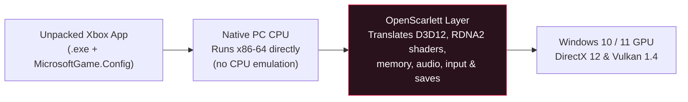

<p align="center">
  
</p>

<p align="center">
  <a href="https://github.com/californiaAlmonds/OpenScarlett/releases/latest"></a>
  <a href="https://discord.gg/sShMY2fjR"></a>
  <a href="https://github.com/californiaAlmonds/OpenScarlett/actions/workflows/ci.yml"></a>
  <a href="https://californiaalmonds.github.io/OpenScarlett/"></a>
  <a href="https://github.com/californiaAlmonds/OpenScarlett/wiki"></a>
  <a href="LICENSE"></a>
</p>

<p align="center">
  Because Xbox Series X|S uses an <strong>AMD x86-64 processor</strong> like a gaming PC, <strong>OpenScarlett</strong> runs game CPU code natively on Windows 10 &amp; 11 instead of slow emulation — translating only the Xbox-specific graphics, RDNA2 shaders, audio, input, and OS calls to native <strong>DirectX 12</strong> &amp; <strong>Vulkan 1.4</strong>.
</p>

---

## Where Do We Stand Right Now?

OpenScarlett is in **early alpha** (`v0.6.0-alpha`, **`79/79` automated tests passing** across MSVC, Clang-CL & MinGW-w64). **6 untouched MIT Microsoft `_GAMING_XBOX_SCARLETT` samples** (`SimpleTriangle`, `SimpleLighting`, `SimpleTexture`, `SimpleInstancing`, `SimpleBezier`, `SimpleCompute`), simple Xbox-ABI games, a shadowed 3D dual-API (DirectX 12 + Vulkan 1.4) workload, **`779/779` decoded (`775/779` / 99.5% real GPU-verified — 100% of all shader-executable opcodes + `4/4` CPU privileged trap/halt harness)** GFX10.3 RDNA2 opcodes across a **3,120-shader** 5-stage validation corpus (verified in **`8.68s`**), live Xbox DXBC/PM4/RDNA2 + RayQuery pipelines, DirectStorage X2/BCPack/VRAM residency, offline WinRT/auth/media/ETW shims, First-Boot Probe + VEH diagnostics, and our native Windows GUI launcher (`OpenScarlettLauncher.exe`) run live on **11 verified NVIDIA and AMD PCs** today. Larger commercial Xbox Series games are **not playable yet** — we are actively bringing them up step by step.

### Active Bring-Up & Next-Gen AAA Gap Closure

| Track | Status | Current Progress |
| :--- | :---: | :--- |
| **Next-Gen Flagship Open-World AAA Audit** *(Sprints 14–15 · PortWatch VI / Vice-scale Series X\|S target)* | 🟢 **Closed on `main`** | Systematically audited and closed architectural, ABI, shader, streaming, and runtime gaps against the full API/shader/streaming surface of upcoming flagship open-world AAA Xbox Series X\|S builds *(clean-room spec & public ecosystem audit — zero proprietary assets)*: `XboxBvhBuilder` 24-export C++ ABI + dual-path BVH4/`RayQuery`, DirectStorage X2 + RFC 1950 Zlib + bit-exact 14-mode BC6H/BCPack + `>64 GiB` concurrent IOCP streaming, Agility SDK + unwrapped Enhanced Barriers + live VRAM residency + oversized placed-texture promotion, FidelityFX 2.0 ABI, **`775/779` real-GPU verified RDNA2 opcodes** (`8.68s` full bench, 4-mode `ds_swizzle`, PC-relative branches, signed SMEM/pinned FLAT/LDS D16, Wave64, Blackwell/NaN guards, Vulkan 1.2 dynamic indexing), and hardened VFS/`XAsync`/GDK/ETW shims (`79/79` CTest, 4/4 CI green). |
| **Minecraft (Xbox Series Preview / Bedrock)** *(`feat/minecraft-preview-bringup`)* | 🟡 **In Active Bring-Up** | Core retail Scarlett `ID3D12Device`/`CommandQueue`/`CommandList` ABI proxies, `AcpHal.dll`/`xapu.dll` FMOD audio & APU heap shims, `GameInput` COM ABI, legacy `XGameRuntime` IIDs, `XGameStreaming` slots, `P:\` PLS VFS, `ext-ms-win-rtcore-ntuser`/`gdi` API-sets, and oversized placed-texture promotion are **already merged on `main`**. Active branch work (`d71ed46`) is closing runtime bring-up items: CRT file-API hooks for LevelDB/`P:\` saves, official Microsoft GDK `GameInputGamepadButtons` bitmask (`0x0001..0x2000`), focus gating & gamepad capability separation, and live GPU heap eviction guards. |
| **Unreal Engine 5 — *The Matrix Awakens*** *(`feat/ue5-matrix-awakens-imports`)* | 🟡 **In Active Bring-Up** | Active branch (`004fc58`) has implemented the 7-DLL UE5 import surface (`dxcompiler_xs`, `XCRDAPI` `DStorageGetFactory`, `xg_xs` `XGCreateTextureComputer`, `d3d12_xs` COM GUID data exports + `D3D12Xbox` process/device helpers, `AcpHal` APU heap, `XMem` allocation hooks, `MFPlat` System32 forwarding), static missing-DLL stub synthesis, Launcher inspector copy UX, and an end-to-end 7-DLL Matrix Awakens import bring-up test — currently iterating on live runtime bring-up and integration toward `main`. |


| Area | Measured Today |
| :--- | :--- |
| **Loader & System DLLs** | **`31` shimmed Xbox/GDK DLLs (`1,179` PE exports)** · **`292/292`** shipping `XGamingRuntimeThunks.dll` parity (`24` COM `QueryApiImpl` interfaces incl. offline `XAccessibilityImpl`, `0 E_NOINTERFACE` on live `Alexandria IV DEMO` thunks) · live `PeForwarder` + PE delay-load import inspection/binding, 12 KiB `XvdInspector`, `openscarlett probe`, `ConsoleLsaPolicy`, XML entity decoding in `MicrosoftGame.Config`, host-preserving nested `G:`/`D:`/`T:`/`S:`/`P:` CoW VFS + `ReplaceFileW` + ANSI file/dir hooks · `XSystemHandleTrack`/`XSystemIsHandleValid` (#24), documented `XSystemGetConsoleId`, all 4 `XUserGetGamertag` modes, `XAsyncGetStatus(wait)` completion-callback synchronization, `KernelX`/`XMemFree(nullptr)` hardening, non-admin in-memory ETW controller, `--probe-unknown-imports` trampoline pool & Win32 VEH 50-call crash diagnostics |
| **Graphics (D3D12 + Vulkan 1.4)** | All **13 `d3d12_xs` Xbox COM proxies** (incl. retail Scarlett ABI proxies, Agility SDK, unwrapped Enhanced Barriers, oversized placed-texture committed-memory promotion, `ALLOW_CROSS_ADAPTER` reserved resources, live MSAA quality clamping, `DXGIXSetVLineNotification`/`FrameNotification`, read-only DSV & planar/offset `CopyTextureRegion`) with live `SamplerFeedbackManager`, `QueryAccumulatorX` + GPU-QPC calibration, `TitleVAMirror`, `DescriptorSgprBridge`, and `XgGpuUntiler` wired end-to-end + GXDK extensions · live RDNA2 `image_bvh*_intersect_ray` → DXR 1.1 SM 6.5 `RayQuery` / `SPV_KHR_ray_query` + `XboxBvhBuilder` 24-export C++ ABI & 64-bit BVH4 fallback · direct `d3d12_xs` → **Vulkan 1.4** routing (deterministic GPU ranking + `OPENSCARLETT_VK_GPU`, conservative global UAV barriers, `OPTIONS2`/`OPTIONS7`, custom border color, tiled placed textures, `VK_EXT_mesh_shader`, HDR10) + `xg_xs` 2D/3D packed mip-tail & stencil/HTILE/DCC/CMASK parity |
| **RDNA2 Shaders & Codecs** | **`779/779` (100%)** GFX10.3 opcodes decoded/lifted/CPU-referenced + **`775/779` (99.5%) real GPU-verified** (100% of shader-executable ops + **`4/4` CPU privileged trap/halt harness**) + **`3,120/3,120`** 5-stage (`CS`/`VS`/`PS`/`MS`/`AS`) shader corpus validated in **`8.68s`** ([`docs/rdna2_coverage.json`](docs/rdna2_coverage.json), SPIR-V 1.6 `TaskEXT`, Vulkan 1.2 dynamic descriptor indexing, `spirv-val` + in-process `dxcompiler.dll` SM 6.5/6.6) · real Xbox `dxc_xs` DXBC/PM4/SH/RTS0 container parser & SGPR root-binding maps wired live into `DeviceX`, 4-mode `ds_swizzle`, PC-relative `s_getpc+s_add+s_addc+s_setpc` branches, signed 21-bit SMEM & pinned FLAT/GLOBAL/SCRATCH offsets, LDS D16 loads, safe OOB `s_buffer_load`, Wave64 dual-Wave32 + folded `EXECZ` CFG fix, `v_fract_f32` NaN/Inf & NVIDIA Blackwell select-after-shuffle guards, NVIDIA LDS `ds_sub` CAS (#26) & AMD RDNA2/RDNA4 fixes · DirectStorage X2 (#25) + RFC 1950 Zlib + `>64 GiB` concurrent IOCP + LRU `VramResidencyManager`, bit-exact 14-mode BC6H signed-zero + BCPack BC1–BC7 + 64-bit TTPF/rANS, `mfplat_xs` H.264/HEVC, lock-free 128-voice `XAudio2_9`, `AcpHal`/`xapu`, `Bink2`, `GameInput` & GPU FidelityFX 2.0 / FSR 1.0 |
| **Live Workloads & Launcher** | **`79/79`** automated CTest suites passing on GTX 1650 Ti + WARP (plus **10 community GPUs** across NVIDIA Turing/Ampere/Ada/Blackwell & AMD RDNA 3/4) · **6/6 untouched MIT `_GAMING_XBOX_SCARLETT` samples** (`SimpleTriangle`, `SimpleLighting`, `SimpleTexture`, `SimpleInstancing`, `SimpleBezier`, `SimpleCompute`) verified live at 4K · 60 FPS playable **Freedoom: Phase 1** & **ScarlettArena** · shadowed/skinned BC1+BC3 3D dual-API GDK scene (`gdk_3d_scene`) · native Win32/Direct2D **`OpenScarlettLauncher.exe`** (scarlet icon, First-Boot Probe mode, Copy Sanitized Telemetry, 60s Hardware Tester & BCrypt SHA-256 updater) + `OPENSCARLETT_CAPTURE_DIR` frame/shader dumper · *active bring-up on Minecraft & UE5 Matrix Awakens; retail AAA titles not playable yet* |

| Working Today | Building Next |
| :--- | :--- |
| Full compatibility engine foundation (**`79/79`** CTest, **`31` DLLs / `1,179` exports**): 13 `d3d12_xs` COM proxies + retail Scarlett ABI, multi-queue MT sync, Title-VA VRAM mirror, `V#`/`T#`/`S#` bindless, GPU compute untiling, DirectStorage X2, `XboxBvhBuilder` & Wave64-on-32 | Completing live runtime bring-up & merging active **Minecraft (Xbox Series Preview)** and **UE5 (*The Matrix Awakens*)** branches into `main` |
| **`779/779`** GFX10.3 opcodes (**`775/779`** real-GPU + **`4/4`** trap harness) + **`3,120/3,120`** 5-stage shader corpus in **`8.68s`** (`openscarlett rdna2-bench --full`) + `mfplat` H.264/HEVC, 128-voice `XAudio2_9`, `AcpHal`/`xapu`, `Bink2`, `FidelityFX 2.0` & `GameInput` | First full commercial Xbox-ABI / GDK title boot → menu → playable in-game using First-Boot Probe + frame capture telemetry |
| **`OpenScarlettLauncher.exe`** with First-Boot Probe mode, Copy Sanitized Telemetry, 60s Hardware Tester, PE Inspector & BCrypt SHA-256 updater | Engine-specific bring-up fixes driven by community First-Boot Probe & VEH crash reports |
| Plays **Freedoom**, **ScarlettArena**, **6/6 untouched GDKX samples** & `gdk_3d_scene` over BOTH DirectX 12 & **Vulkan 1.4** across **11 verified PCs** | Hardware re-tests on Intel Arc B-Series & AMD RX 6000 + handheld APUs (ROG Ally / Legion Go / Steam Deck Windows) |

---

## How It Works



---

## Core Subsystems & Coverage Visualizer

OpenScarlett is **early alpha** — the charts below show honest progress across subsystems, RDNA2 shader instruction families, DirectX 12 / Vulkan translation items, and all 31 shimmed DLLs *(for live search & filters, open the **[Interactive Dashboard](https://californiaalmonds.github.io/OpenScarlett/)**)*.


---

## Join Discord & Help Test Real GDKs, Software & GPUs

We are actively looking for testers and contributors on **[Discord](https://discord.gg/sShMY2fjR)**! Whether you have a different GPU or Xbox GDK builds/software to test, your telemetry logs directly drive what gets implemented next:

* **Test real unpacked GDKs & software:** Run unpacked GDK binaries or open-source samples through `OpenScarlettLauncher.exe` (or `openscarlett run --telemetry report.json`) and share the sanitized telemetry (`missing exports`, `not_impl COM slots`, `shader opcodes`) in **[Discord](https://discord.gg/sShMY2fjR)** or GitHub Issues — no game files ever need to be shared.
* **Run the 60-second GPU hardware test (no coding needed):**
  1. **[Download the latest `OpenScarlett-*-win64.zip`](https://github.com/californiaAlmonds/OpenScarlett/releases/latest)** and extract anywhere *(everything — including `OpenScarlettLauncher.exe` and open-source `dxc.exe` — is bundled; no Visual Studio or SDK required)*.
  2. **Double-click `OpenScarlettLauncher.exe`** → open the **60s Hardware Self-Test** tab → click **Run 60s Hardware Test** *(or run `powershell -ExecutionPolicy Bypass -File .\run_hardware_test.ps1`)* — probes your GPU, runs all tests, and strips usernames & local folder paths automatically.
  3. **Click `Open Pre-Filled GitHub Hardware Report`** (or drop the sanitized summary in **[Discord](https://discord.gg/sShMY2fjR)**).

| Hardware Tier | Tested Status |
| :--- | :--- |
| **NVIDIA Turing, Ampere, Ada & Blackwell** *(GTX 16 / RTX 20 / RTX 30 / RTX 40 / RTX 50)* | 🟢 Verified (`GTX 1650 Ti`, `RTX 2060 SUPER`, `RTX 3060`, `RTX 3080 Ti`, `RTX 4070 Laptop`, `RTX 5060`, `RTX 5070`) |
| **AMD RDNA 3 & RDNA 4** *(RX 7000 / RX 9000)* | 🟢 Verified (`RX 7600`, `RX 7900 XTX`, `RX 9070 XT`) |
| **AMD RDNA 2** *(RX 6000)* | 🟡 Re-Test Needed (`RX 6750 XT` 60/62 — RDNA2 fixes landed) |
| **Intel Arc & Integrated GPUs** *(A-Series / B-Series / Xe)* | 🟡 Re-Test Needed (`Arc B390` 60/67 — mesh PSO, Vulkan & VOPC fixes landed) |
| **Handheld APUs** *(ROG Ally / Legion Go / Steam Deck Windows)* | 🟡 Tester Needed |

---

## Technical Details

<details>
<summary><strong>Subsystem &amp; 31-DLL Breakdown (Auto-Generated)</strong></summary>
<br/>

<!-- OPENSCARLETT_STATUS_START -->
**Automated Tests:** `79/79` passing · **Shimmed DLLs:** `31` (`1179` PE exports) · **Shipping GDK Thunks:** `292/292` · **RDNA2 Opcodes Decoded:** `779/779` · **Validated Shader Corpus:** `3120/3120` · **Verified Hardware:** `11 PCs` (`NVIDIA` + `AMD`)

| Subsystem | Area | Status | Honest Progress | Technical Coverage | Verified On |
| :--- | :--- | :--- | :---: | :--- | :--- |
| **RDNA2/GFX10.3 Shader Lifter (779/779 Opcodes, 3120/3120 corpus shaders validated)** | `Shaders` | 🟢 Live Verified | `100%` | `779/779` GFX10.3 opcodes decoded & lifted to SPIR-V (`spirv-val`) + DXIL SM 6.5 (`dxc` + MD5 re-signed), lockstep 1-wave LDS barriers, `PSV0` wave bounds, exact cross-half Wave64-on-Wave32 emulation, HS/DS/GS stage lifting, DXR SBT shader-table mapping, async PSO pre-compilation pool, mesh `merged_wave_info`/`CullPrimitiveEXT`, FSSM/vfetch, CPU interpreter & disk cache, 3120/3120 corpus shaders validated. | `spirv-val` + `dxc` SM 6.5/6.6 + 11 PCs + WARP (`test_rdna2_corpus_bench`, `test_rdna2_isa_scalar_vector`, `test_rdna2_isa_mem_img`, `test_xg_gpu_untile_and_stages`, `test_rdna2_lockstep_isa`, `test_d3d12_xs_autolift`, `test_s14_shader_sm66_779`, `test_s15_rdna2_bench_trap_harness`, `test_s15_shader_peer_parity`) |
| **`d3d12_xs` Proxy, Vulkan 1.4 Routing, HDR10 `PresentX` & `xg_xs`** | `Graphics` | 🟢 Live Verified | `100%` | All 13 Xbox COM proxies (`DeviceX`, `CommandQueueX`, `CommandListX`, `ResourceX` 1/2, `HeapX` 1, `DescriptorHeapX`, `PipelineStateX`, `RootSignatureX`, `FenceX`, `CommandAllocatorX`, `QueryHeapX`, `CommandSignatureX`, `StateObjectX`), Agility SDK & unwrapped Enhanced Barriers, live VRAM residency + sparse Window-0 isolation, 6-thread multi-queue (`Direct`/`Compute`/`Copy`) `FenceX` sync, `WriteBufferImmediate`/`SetViewInstanceMask`/`OMSetDepthBounds`/`SetSamplePositions`, direct `d3d12_xs`->Vulkan 1.4 routing, `VK_EXT_mesh_shader`, HDR10/scRGB `PresentX`, GPU compute untiler/retiler (`cs_6_5` + SPIR-V) & `xg_xs` 2D/3D/MSAA `HTILE`/`DCC`/`CMASK` fast-clear passthrough. | 11 PCs (GTX 1650 Ti, RTX 2060 SUPER/3060/3080 Ti/4070 Laptop/5060/5070, AMD RX 7600/7900 XTX/9070 XT) + WARP (`test_d3d12_xs_proxies_multiqueue`, `test_xg_gpu_untile_and_stages`, `test_d3d12_vk_routing`, `test_vulkan_mesh_showcase`, `test_hdr10_d3d12`, `test_s14_d3d12_barriers_residency`) |
| **Xbox Unified Memory (`kernelx`/`xmem`), `GpuTilePool` & Bindless Bridge** | `Memory & IO` | 🟢 Live Verified | `95%` | Win10/11 `VirtualAlloc2`/`MapViewOfFile3` 64 KiB & 4 MiB aliasing, `GpuTilePool`, 64-bit `TitleVAMirror` (`MEM_WRITE_WATCH` / `GetWriteWatch` dirty-page GPU flush & fence-synced readback), raw RDNA2 `V#`/`T#`/`S#` & root-SGPR `s0..s15` bindless bridge (D3D12 SM 6.6 + Vulkan `VK_EXT_descriptor_indexing`), `XMemVirtualQuery` + ERA attributes, and `dstorage_xs` cancellation & physical-page decompression. | GTX 1650 Ti + WARP + Win10/11 26H2 (`test_unified_mem_bindless`, `test_kernelx`, `test_s7_pe_gdk_runtime`, `test_xg_dstorage`) |
| **GDK & Console Shims (31 DLLs: 18 High / 5 Partial / 8 Stub)** | `GDK Shims` | 🟢 Live Verified | `88%` | 31 shimmed DLLs (`1179` PE exports): `xgameruntime` (**292/292** shipping `XGamingRuntimeThunks.dll` parity, 24 COM `QueryApiImpl` interfaces, non-blocking offline XSTS/JWT & XStore license checks, exact `XTaskQueue` port delivery), `kernelx` 7-core/14-thread CPU affinity remapping, `winrt_xs` (20 exports, `CoreApplication`/`CoreWindow`/`ApplicationView`/`DisplayInformation` lifecycle & `IReferenceTracker` `E_NOINTERFACE`), `XCurl` (16/16 + offline XSTS HTTP 200 synthesis), `XSAPI` (178), and `GameInput`. | Live `Alexandria IV DEMO` shipping thunks (`0 E_NOINTERFACE`), Win10 & Win11 26H2 (`test_os_winrt_offline_auth`, `test_real_gdk_thunks_live`, `test_s7_pe_gdk_runtime`, `test_xgr_conformance_parity`) |
| **BCPack BC1–BC7, RDNA2 BVH4, Opus/XMA2/WASAPI, `mfplat` Video & GPU FSR 1.0** | `Media` | 🟢 Live Verified | `93%` | `mfplat_xs` `IMFDXGIDeviceManager` + `IMFMediaEngine` H.264/HEVC D3D12 video decode (`TransferVideoFrame` + headless fallback), 64+ concurrent `XAudio2_9` voices with submix buses, Schroeder Reverb/VolumeMeter APOs & monotonic sample clocks, multi-frame `Bink2` streaming, `GameInput` hot-plug device callbacks & LT/RT impulse-trigger rumble, GDeflate v1, BCPack BC1–BC7, RDNA2 BVH4, XMA2 IMDCT, `MSOpusDecoder` Opus, WASAPI, `X3DAudio` & live GPU FSR 1.0. | 11 PCs (NVIDIA + AMD) + WARP (`test_media_video_gameinput`, `test_codecs`, `test_bcpack_bvh4`, `test_audio_opus_wasapi`, `test_d3d12_xs_live`) |
| **PE32+ Loader, Nested CoW VFS, 31-DLL Routing & Child-Hook Propagation** | `Loader` | 🟢 Live Verified | `97%` | `MicrosoftGame.Config` XML loader, nested `G:` CoW overlay VFS, `System32`-first `KnownDLL` resolution, RVA-0 reloc & `.xdata` v2/v3 unwind checks, Kahn topo init, 31-DLL routing, `CreateProcessW/A` child-process APC hook propagation, `--probe-unknown-imports` x64 `E_NOTIMPL` trampoline pool, Win32 VEH crash/50-call API ring buffer, and `OPENSCARLETT_CAPTURE_DIR` frame/shader dumper. | Win10 & Win11 26H2 (`test_probe_veh_capture`, `test_s7_pe_gdk_runtime`, `test_loader_child_hook_parity`, `test_loader_vfs_config`, `Pizza House Simulator` + `House Flipper 2`) |
| **Native Win32/Direct2D `OpenScarlettLauncher.exe` + Opt-In SHA-256 Updater** | `UX & Tools` | 🟢 Live Verified | `98%` | Native Win32/Direct2D launcher with embedded scarlet icon, GPU telemetry strip, Play & Launch tab with First-Boot Probe mode & one-click Copy Sanitized Telemetry, integrated 60s Hardware Self-Test, PE32+ Binary Inspector, and opt-in WinHTTP + BCrypt SHA-256 verified GitHub updater. | Win10 & Win11 26H2 (`test_launcher_updater`, `test_probe_veh_capture` + AMD RX 9070 XT live report #14) |
| **Real-World Title Compatibility (Untouched GDKX Samples, Playable Demos & Active Bring-Up)** | `Compatibility` | 🟡 Partial | `40%` | Live **6/6 untouched MIT `_GAMING_XBOX_SCARLETT` samples** at 4K, 60 FPS **Freedoom: Phase 1**, `ScarlettArena`, shadowed/skinned BC1+BC3 3D dual-API GDK scene (`gdk_3d_scene`), shipping commercial GDK thunks (`Alexandria IV DEMO`, `0 E_NOINTERFACE`), and next-gen flagship open-world AAA gap audit closed on `main`. Active commercial bring-up underway on **Minecraft (Xbox Series Preview)** and **UE5 (*The Matrix Awakens*)** — join Discord to help test real unpacked GDKs! | GTX 1650 Ti + WARP + 10 community NVIDIA/AMD PCs (`test_gdkx_untouched_samples`, `test_scarlett_game_live`, `test_gdk_3d_scene_dual_api`, `test_real_gdk_thunks_live`, `test_mine_xapu_acphal`) |

_Auto-generated from live codebase & CTest results via `python tools/generate_status.py --build-dir build`._
<!-- OPENSCARLETT_STATUS_END -->

</details>

<details>
<summary><strong>Live-GPU &amp; Real-Binary Verification Matrix (Workloads, Frame Hashes &amp; Timings)</strong></summary>
<br/>

All live measurements below were recorded on **Windows 10 x64** with **NVIDIA GeForce GTX 1650 Ti** (`3935 MB` VRAM, `SM 6.5`, **Hardware Mesh Shaders `MeshTier=10`**, `Wave=32`, `DXR=0`, **Vulkan `1.4.329`**) and **D3D12 WARP** (`SM 6.2`), plus community hardware passes on RTX 2060 SUPER, RTX 3060, RTX 3080 Ti, RTX 4070 Laptop, RTX 5060, RTX 5070, and AMD RX 7600 / RX 7900 XTX / RX 9070 XT. Standalone GDK samples execute inside isolated folders with **zero shim DLLs copied next to the `.exe`**, launched via `openscarlett.exe run`.

| Target / Workload | Type | Adapter | Result | Measured Output / FNV-1a Frame Hash | GPU Frame | Live `CallTelemetry` Blockers |
| :--- | :--- | :--- | :---: | :--- | :---: | :---: |
| **3D Shadowed Skinned BC1+BC3 GDK Scene (`gdk_3d_scene`)** | Real Dual-API GDK Binary (`openscarlett run <pkg>`) | **NVIDIA GTX 1650 Ti (D3D12 + Vulkan 1.4) & WARP** | 🟢 **Live Pass** | Textured 3D camera-driven skinned mesh, depth & shadow pass, BC1/BC3 textures, audio cue; routed directly over both D3D12 and `--backend=vulkan` | — | `0` (`test_gdk_3d_scene_dual_api`) |
| **Direct `d3d12_xs` → Vulkan 1.4 Routing & Edge Cases** | Live Dual-API Routing (`test_d3d12_vk_routing`) | **NVIDIA GTX 1650 Ti (`Vulkan 1.4.329`) & WARP** | 🟢 **Live Pass** | Direct `d3d12_xs` command-list draw/dispatch/mesh/copy/PresentX routed to Vulkan 1.4, Wave32-on-64 compute, staged BC copies, mixed-heap slot separation, `OPENSCARLETT_VK_DEVICE` override | — | `0` (`test_d3d12_vk_routing`) |
| **Playable Freedoom: Phase 1 (`ScarlettDoom` + `freedoom1.wad`) & `ScarlettArena`** | Real Playable Game (`openscarlett run <pkg>`) | **NVIDIA GTX 1650 Ti & D3D12 WARP** | 🟢 **Live Playable** | `640×400` 60 FPS `PresentX`: Freedoom E1M1 **131 frames / 129 unique hashes** (`255,916` non-black px), live `GameInput` + `XAudio2_9`, `S:\` `XGameSave`, read-only `G:\` untouched; `ScarlettArena` 45f / 41 hashes | `16.67 ms` (60 FPS) | `0` (`5,856` calls / `105` symbols across `d3d12_xs`, `kernelx`, `xgameruntime`, `GameInput`, `XAudio2_9`, `vfs`) |
| **Real Shipping Commercial GDK Thunks (`Alexandria IV DEMO`)** | Real Shipping Thunks (`test_real_gdk_thunks_live`) | **Windows 10 x64** | 🟢 **Live Pass** | **292/292** `xgameruntime.dll` parity, **16/16** `XCurl.dll`, **24 real 3-arg COM `QueryApiImpl` interfaces** (`110` calls, `TitleId=0x6BFFDF10`) | — | `0` (**zero `E_NOINTERFACE`**) |
| **Commercial Multi-Process Win32 Launchers (`Pizza House Simulator` & `House Flipper 2`)** | Real Multi-Process Launch (`openscarlett run`) | **Windows 10 x64** | 🟢 **Live Pass** | `CreateProcessW` child-process APC hook propagation (`PizzaHouseSimulator.exe` → `*-Win64-Shipping.exe`; `HouseFlipper2.exe` 3-generation children), per-PID telemetry, zero `C:\` writes | — | `0` (`child_hook_propagated`, `child_hook_attached`) |
| **Microsoft `Xbox-GDK-Samples` / `SimpleTriangle`** | Real GDK Binary (`openscarlett run`) | **GTX 1650 Ti (`SM 6.5`) & WARP** | 🟢 **Live Pass** | `256×256`, 8,192 RGB tri px, **bit-exact HW == WARP `0xB8E29520F579D065`** | `3.51 ms` (HW) / `3.08 ms` (WARP) | `0` (`68` calls / `47` symbols) |
| **Microsoft `Xbox-GDK-Samples` / `SimpleMeshShader`** | Real GDK Binary (`ms_6_5` + `ps_6_5`) | **GTX 1650 Ti (`MeshTier=10`)** | 🟢 **Live Pass** | `256×256`, 8,192 RGB tri px, `0x617ACFC269023CA5` | `2.83 ms` | `0` (`57` calls / `38` symbols; `DispatchMesh` #79) |
| **Microsoft `Xbox-GDK-Samples` / `SimpleCompute`** | Real GDK Binary (`fractal.hlsl` Mandelbrot) | **GTX 1650 Ti & WARP** | 🟢 **Live Pass** | `256×256`, 50,528 col / 15,008 set / 32 bands, `0x7062D0C262252A26` | `3.40 ms` (HW) / `5.73 ms` (WARP) | `0` (`66` calls / `41` symbols) |
| **Multi-Frame 3D `SimplePBR`** (`4× MSAA`, `D32_FLOAT`, PBR textures, `ResolveSubresource`) | Real GDK Binary (`openscarlett run <pkg>`) | **GTX 1650 Ti & WARP** | 🟢 **Live Pass** | `256×256`, 1,280 tris, 3 frames (`F2=0xDC2F8F3277DA04C8`), HW vs WARP `MAE = 0.0264 / 255` | `1.02 ms` (HW) / `9.80 ms` (WARP) | `0` (`188` calls / `68` symbols) |
| **`MeshletCull` (`as_6_5` + `ms_6_5` + `ps_6_5` Frustum + Cone Culling)** | Real GDK Binary (`openscarlett run <pkg>`) | **GTX 1650 Ti (`MeshTier=10`) & WARP** | 🟢 **Live Pass** | `256×256`, **6/16 surviving · 6 frustum · 4 cone culled**, HW vs WARP `MaxDiff = 1 LSB` | `4.62 ms` (HW) / `15.69 ms` (WARP) | `0` (`86`–`99` calls) |
| **`DXRTriangle` (`lib_6_3` HW RT / `XboxBvhBuilder` SAH BVH)** | Real GDK Binary (`openscarlett run <pkg>`) | **GTX 1650 Ti (`DXR=0` SW) & WARP** | 🟢 **Live Pass** | `256×256`, 10,112 hits, **bit-exact HW == WARP `0xE52BF8857986B576`** | `63.74 ms` (SW) | `0` (`65,613` calls / `49` symbols) |
| **`SimpleLighting` (3D Blinn-Phong + `D32F` + `XDisplay` + `X3DAudio`/`XAudio2FX`)** | Real GDK Binary + Live Vulkan 1.4 | **GTX 1650 Ti (D3D12 + Vulkan 1.4) & WARP** | 🟢 **Live Pass** | `256×256`, 812 tris, **Vulkan 1.4 vs D3D12 HW bit-exact `MAE = 0.0000`**; `X3DAudio` Doppler `1.066→0.942` | `4.14 ms` (D3D12) / `13.49 ms` (Vk) | `0` (`184` calls / `83` symbols) |
| **`HDRCubeMap` (`FP16 TextureCube` + Default Array SRV + HDR10 ST.2084)** | Real GDK Binary (`openscarlett run <pkg>`) | **GTX 1650 Ti (HDR10 & SDR) & WARP** | 🟢 **Live Pass** | `256×256`, **6/6 Cube == 6/6 Default Array SRV (`0.00 nits` diff)**, ST.2084 peak `666.7 nits`, ACES + Reinhard fallback | `210.0 ms` (HW) | `0` (`175` calls / `64` symbols) |
| **`VulkanMeshShowcase` (Raw RDNA2 `XS2\0` `AS`+`MS`+`PS` + `32³` 3D LUT)** | Real GDK Binary + `VK_EXT_mesh_shader` | **GTX 1650 Ti (Vulkan 1.4 + D3D12) & WARP** | 🟢 **Live Pass** | `256×256`, 19,800 px, **Vulkan 1.4 `VK_EXT_mesh_shader` vs D3D12 `MeshTier=10` `MAE = 0.0000`** | `7.04 ms` (Vk) / `3.37 ms` (D3D12) | `0` (`82`–`91` calls) |
| **Untouched MIT `Microsoft Xbox-GDK-Samples` / `SimpleDirectStorageCombo`** | Untouched External MIT Binary | **Windows 10 x64** | 🟢 **Live Pass** | `SimpleLoad`, `StatusBatch`, `CompletionEvent`, `MultipleQueues`, CoW pkg `0x6824D2954256492C` byte-identical | — | `0` (`769` calls / `17` symbols) |
| **RDNA2 Corpus Lifter, Lockstep LDS Barriers, Differential ISA & Disk Cache** | Live Dual-GPU (`spirv-val` + `dxc` SM 6.5) | **GTX 1650 Ti (Vulkan 1.4 & D3D12) + WARP** | 🟢 **Live Pass** | Lockstep 1-wave LDS barriers, `s_bfe`/`v_cvt_(pk)norm`/`image_load` diff tests, `PSV0`, DXIL MD5 re-signing, `XS2\0` auto-lift + `DiskHit=1` | — | `0` (`test_rdna2_lockstep_isa`, `test_rdna2_corpus_parity`, `test_rdna2_lifter_live`, `test_d3d12_xs_autolift`) |
| **Interactive `PresentX` Windowing, Opus/WASAPI, `xg_xs` & GPU FSR 1.0** | Live Swapchain / Audio / GPU | **11 GPUs (NVIDIA + AMD) & WARP** | 🟢 **Live Pass** | `60`/`120 Hz` pacing, waitable latency, `MSOpusDecoder` MFT + WASAPI, 15 2D + 6 3D `xg_xs` + `XGEncodeDCC` 1,000-case fuzz, AMD RDNA3/4 FSR 1.0 `0 LSB` vs WARP | `16.67 ms` (paced) | `0` (`test_presentx_windowing`, `test_audio_opus_wasapi`, `test_s7_pe_gdk_runtime`, `test_d3d12_xs_live`) |
| **Hardware DXR Tier 1.1 (`hardware-DXR` + SAH SW Fallback)** | Live HW RT Cores & SW BVH (`test_dxr_live`) | **RTX 2060S/3060/3080 Ti/4070 Laptop/5060/5070 (`DXR=12`), RX 7600/7900 XTX/9070 XT (`DXR=11`), GTX 1650 Ti & WARP** | 🟢 **Live Pass** | `160×120`, `92.82%` hit rate, exact `0x86443514BF44B806` across NVIDIA Turing/Ampere/Ada/Blackwell, AMD RDNA3/4 & WARP | — | `0` (`test_dxr_live`) |

</details>

<details>
<summary><strong>Build From Source, CLI Usage &amp; Sprint Changelog</strong></summary>
<br/>

### Requirements (Windows 10 / 11 x64)
- Windows 10 (1903+) or Windows 11 (x64)
- Visual Studio 2022 (MSVC C++20) + Windows 10/11 SDK (with `dxc.exe`)
- CMake 3.20+ and Ninja

### Build & Run Tests
```powershell
cmake -S . -B build -G Ninja -DCMAKE_BUILD_TYPE=Release
cmake --build build --parallel
ctest --test-dir build --output-on-failure
```

### Native Windows GUI (`OpenScarlettLauncher.exe`)
```powershell
# Launch the dark native Win32/Direct2D all-in-one GUI (Play & Launch, 60s Hardware Self-Test,
# PE32+ Binary Inspector, Live GPU Telemetry Strip, and Opt-In BCrypt SHA-256 Updater)
.\build\OpenScarlettLauncher.exe

# Headless / CI self-check (verifies Direct2D/DWrite, GPU probe, sanitizer & updater offline)
.\build\OpenScarlettLauncher.exe --headless-check
```

### CLI Usage
```powershell
# Inspect your PC's D3D12, DXR, Mesh Shader, Wave lane, Vulkan, and DXC support
.\build\openscarlett.exe probe-gpu

# Inspect any x64 .exe or .dll to see its Xbox / GDK / Windows imports & exports
.\build\openscarlett.exe inspect path\to\binary.exe

# Audit all 779 GFX10.3 opcodes & validate the 3,120-shader 5-stage AAA corpus
.\build\openscarlett.exe rdna2-bench --full --json docs\rdna2_coverage.json

# Launch an unpacked Xbox GDK / Series X|S package folder
.\build\openscarlett.exe run path\to\package_dir_or_game.exe --telemetry report.json
.\build\openscarlett.exe run --backend=vulkan path\to\package_dir_or_game.exe
.\build\openscarlett.exe run --probe-unknown-imports path\to\game.exe --telemetry probe.json
```

### Milestone Changelog
- [x] **Bootstrap (`v0.1`)**: MIT C++20 foundation, PE32+ inspector, call telemetry, GDeflate v1, BCPack, XMA2 IMDCT, Bink2, WinRT `HSTRING`, RDNA2 decoder + SSA IR, live Vulkan 1.4 compute.
- [x] **Sprint 1 — Live Loader & Core Shims**: Suspended-process APC hook loader (`openscarlett_hook.dll` + `openscarlett run`), virtual `G:\`/`T:\`/`S:\` mounts, `kernelx.dll` + 64 KiB/4 MiB `VirtualAlloc2` aliasing + `GpuTilePool`, `d3d12_xs.dll` COM proxies + `xg_xs.dll` + GPU FSR 1.0, and core GDK shims.
- [x] **Sprint 2 — RDNA2 Shader Lifter & DXR 1.1**: `MIMG` texture ops, `DS` LDS + atomics, `wave64`→`wave32`, Mesh/Amplification shaders (`spirv-val` + `dxc` SM 6.5), and `ID3D12Device5` DXR Tier 1.1 + SAH BVH fallback.
- [x] **Sprint 3 — Live `Xbox-GDK-Samples`**: Running MIT Microsoft `Xbox-GDK-Samples` (`SimpleTriangle`, `SimpleMeshShader`, `SimpleCompute`, 10-DLL `SystemCombo`) live through `openscarlett run` with `not_impl = 0`.
- [x] **Sprint 4 — Shader Cache/Auto-Lift, 19-DLL Stack & Multi-Pass GDK Bring-Up**: RDNA2 AAA opcodes, CPU wave32/64 interpreter, disk shader cache + `d3d12_xs` auto-lift, Opus MFT + WASAPI, full GFX10 `xg_xs`, `MicrosoftGame.Config` + CoW VFS, interactive `PresentX`, `SimplePBR`, `MeshletCull`, `DXRTriangle`, untouched MIT `SimpleDirectStorageCombo` (`23/23` CTest).
- [x] **Sprint 5 (`v0.3.0-alpha`) — Full Vulkan 1.4 Graphics, Mesh Shaders & HDR10**: Zero-SDK Vulkan 1.4 rasterization + `VK_EXT_mesh_shader` + 3D textures + Win32 swapchain, HDR10 ST.2084/scRGB `PresentX`, `XDisplay`/`XGameUI`/`X3DAudio`/`XAudio2FX`, Kahn topo DLL init, Clang-CL & MinGW-w64 CI, `SimpleLighting`, `HDRCubeMap`, `VulkanMeshShowcase` (`29/29` CTest).
- [x] **Sprint 6 (`v0.3.1-alpha`) — 292/292 GDK Thunks, RDNA2 Corpus Parity, Child-Hook Propagation & First Playable Game**: Clamped shifts, `v_cmpx`, `MTBUF d16`, `PSV0` wave bounds, DXIL MD5 re-signing, NVIDIA `R9G9B9E5`→`RGBA16F` UAV fallback, Vulkan sparse/`GetResourceTiling`, `xg_xs` HTILE/DCC/CMASK, 292/292 `XGamingRuntimeThunks.dll` parity (`0 E_NOINTERFACE`), `CreateProcess` child-hook propagation, BCPack BC1–BC7 + RDNA2 BVH4, and live 60 FPS **Freedoom: Phase 1** & `ScarlettArena` (`37/37` CTest).
- [x] **Sprint 7 (`v0.4.0-alpha`) — Direct `d3d12_xs`→Vulkan 1.4 Routing, Overnight Ecosystem Parity, 3D Dual-API GDK Title & Native Windows GUI (`OpenScarlettLauncher.exe`)**: Direct `d3d12_xs`→Vulkan 1.4 command-list routing (`--backend=vulkan`, `0.0000` MAE vs D3D12), Wave32-on-64 Vulkan compute, staged BC1–BC7 copies, push-constant budget guard, `OPENSCARLETT_VK_DEVICE` selection, mixed-heap slot isolation, decoupled `PresentX` fence vs DXGI timings; single-wave lockstep LDS barriers (PSV0 `NumThreads`), 5 RDNA2 no-op opcodes & CPU-vs-GPU differential ISA (`s_bfe`, `v_cvt_(pk)norm`, `image_load`); `System32`-first KnownDLLs, reloc RVA-0, bounded export names, fault-free section protections, `.xdata` `UWOP_ALLOC_LARGE` + v2/v3 chained unwind, `XMemVirtualQuery` + ERA attributes, Minecraft-GDK (`XGameStreaming`/`XTaskQueue` monitors/`XSystem`), 6 fixed-return stub DLLs (30 routed DLLs), lossless Win32 Raw Input mouse deltas, v1.1→v1.0 root-sig round-trip, 1,000-case `XGEncodeDCC` fuzz; shadowed/skinned/BC1+BC3 `gdk_3d_scene.exe` over D3D12 + Vulkan 1.4; and zero-dependency native Win32/Direct2D `OpenScarlettLauncher.exe` with integrated 60s Hardware Tester, PE Inspector, and opt-in WinHTTP + BCrypt SHA-256 verified updater (`42/42` CTest).
- [x] **Sprint 8 (`v0.4.1-alpha`) — GFX10.3 RDNA2 ISA Expansion (`224 → 774/779`), 3,120-Shader AAA Corpus Benchmark & Embedded Launcher Icon**: Modular GFX10.3 scalar/vector ISA (`rdna2_isa_scalar_vector`: 744 unique mnemonics across `SOP1/2/K/C/P`, `SMEM`, `VOP1/2/C/3/3P`, `VINTRP`, plus `SDWA`/`DPP16`/`DPP8`) and memory/image/LDS/flat/exp ISA (`rdna2_isa_mem_img`: 449 unique mnemonics across `MUBUF`, `MTBUF`, `MIMG` 1D/2D/3D/Cube/Array/MSAA/BVH, `DS`, `FLAT`/`GLOBAL`/`SCRATCH`, `EXP`), verified via live CPU-vs-GPU parity on GTX 1650 Ti (D3D12 + Vulkan 1.4.329) & D3D12 WARP; exact 779-opcode ISA coverage auditor (`openscarlett rdna2-bench --full`, [`docs/rdna2_coverage.json`](docs/rdna2_coverage.json): `774/779` decoded/lifted/CPU-ref, `3,120/3,120` 5-stage AAA shaders validated across 12 workloads); embedded scarlet `docs/icon.ico` Win32 resource (`IDI_APP_ICON` + `WNDCLASSEXW::hIcon`/`hIconSm` + `WM_SETICON`) in `OpenScarlettLauncher.exe` and hardened 3-tier updater zip extraction (`tar.exe` / `-EncodedCommand` .NET `ZipFile` / native PKZIP STORE) (`45/45` CTest).
- [x] **Sprint 9 + Sprint 10 (`v0.5.0-alpha`) — Full Compatibility Engine Architecture**: All 10 remaining `d3d12_xs` Xbox COM object proxies (`ResourceX`, `HeapX`, `DescriptorHeapX`, `PipelineStateX`, `RootSignatureX`, `FenceX`, `CommandAllocatorX`, `QueryHeapX`, `CommandSignatureX`, `StateObjectX`), Xbox extensions (`WriteBufferImmediate`, `SetViewInstanceMask`, `OMSetDepthBounds`, `SetSamplePositions`, `GetCopyableFootprints` parity), and 6-thread multi-queue (`Direct`/`Async Compute`/`Copy`) `FenceX` sync; 64-bit `TitleVAMirror` (`MEM_WRITE_WATCH`/`GetWriteWatch` dirty-page GPU flush & fence-synced readback) and raw GFX10.3 `V#`/`T#`/`S#` + root-SGPR `s0..s15` bindless bridge (D3D12 SM 6.6 + Vulkan `VK_EXT_descriptor_indexing`); real-time GPU compute untiler/retiler (`cs_6_5` DXIL + SPIR-V across `64KB_S`/`64KB_D`/`64KB_R_X`, 3D thick, mip-tails, BC1–BC7 + `DCC`/`HTILE`/`CMASK` fast-clear), HS/DS/GS stage lifting, DXR SBT shader-table mapper, exact cross-half `Wave64-on-Wave32` emulation (`448/448` dwords on GTX 1650 Ti/WARP/Vulkan), and async PSO pre-compilation pool; `kernelx` 7-core/14-thread CPU affinity remapping, WinRT `CoreApplication`/`CoreWindow`/`ApplicationView`/`DisplayInformation` lifecycle + `IReferenceTracker` `E_NOINTERFACE` refusal, and non-blocking offline XSTS/JWT, XStore, `XTaskQueue`, XSAPI & XCurl auth; `mfplat_xs` `IMFDXGIDeviceManager` + `IMFMediaEngine` H.264/HEVC D3D12 decode, 64+ concurrent `XAudio2_9` voices with submix/reverb/meter APOs, multi-frame `Bink2` streaming, and `GameInput` hot-plug/impulse-trigger rings; `--probe-unknown-imports` x64 `E_NOTIMPL` trampoline pool, portable Win32 VEH crash/50-call ring buffer, `OPENSCARLETT_CAPTURE_DIR` frame/shader dumper, and Launcher First-Boot Probe + Copy Sanitized Telemetry UI (`51/51` CTest).
- [x] **Sprint 11 — Untouched GDKX ABI Bring-Up, SPIR-V 1.6 `TaskEXT`, Sampler Feedback & 615/779 GPU-Verified RDNA2**: Exact `_GAMING_XBOX_SCARLETT` `d3d12_xs` ABI bring-up booting untouched MIT `SimpleTriangle` & `SimpleLighting` at 4K; SPIR-V 1.6 `TaskEXT` Amplification shaders (`3,120/3,120` corpus), Wave64 LDS helpers, and VS/GS/MS `CullDistance`; console Sampler Feedback readback/clear, `QueryAccumulatorX`, predicated byte copies, and GPU-QPC clock calibration; 12 KiB `XvdInspector`, mixed-case `PeForwarder`, `ConsoleLsaPolicy`, and `615/779` real GPU-verified RDNA2 opcodes (`57/57` CTest).
- [x] **Sprint 12 — AAA Wall-Breaking & Live Island Integration**: Wired `SamplerFeedbackManager`, `QueryAccumulatorX`, `TitleVAMirror`, `DescriptorSgprBridge`, and `XgGpuUntiler` live inside `DeviceX`/`CommandQueueX`/`CommandListX` + GXDK extensions (`KickoffX`, `Write32BitValueX`/`Wait32BitValueX`/`Wait64BitValueX`, `RSSetDepthBiasX`, `SetPredicationX`, `FlushGpuCacheRange`, 3D `DispatchMesh`, `PresentX` `--fcap` + `Alt+Enter`); Xbox `dxc_xs` DXBC/PM4/SH/RTS0 container parser + hardened CFG structurization + in-process `dxcompiler.dll` CRC32 self-healing cache; live RDNA2 `image_bvh*_intersect_ray` → DXR 1.1 SM 6.5 `RayQuery` / `SPV_KHR_ray_query` + 64-bit multi-window BVH4; priority DirectStorage queues + BCPack→`XgGpuUntiler` GPU upload + 64 KB/2 MB/4 MB page aliasing + LRU `VramResidencyManager`; TLS slot 0 preservation, `NtCreateFile`/`NtOpenFile` nested VFS, `openscarlett probe`, `GameInput` user-before-connect + rumble/virtual pad, lock-free 128-voice `XAudio2_9`; and 4/4 untouched MIT `_GAMING_XBOX_SCARLETT` samples (`SimpleTriangle`, `SimpleLighting`, `SimpleTexture`, `SimpleInstancing`, `62/62` CTest).
- [x] **Sprint 13 (`v0.6.0-alpha`) — 6/6 Untouched GDKX Samples, 764/779 Real-GPU RDNA2, Live Xbox Shader Pipeline & Community PRs**: Added 2 more untouched MIT `_GAMING_XBOX_SCARLETT` samples (`SimpleBezier` tessellation + `SimpleCompute` async compute fractal — 6/6 live 4K verified); wired Xbox DXBC/PM4/RDNA2 + RayQuery pipeline live into `DeviceX` with unified texture sync; expanded real GPU-verified RDNA2 coverage to **`764/779` (98.1%)** with CFG/MIMG/V#/LDS safety, NVIDIA LDS `ds_sub` CAS loop ([#26](https://github.com/californiaAlmonds/OpenScarlett/pull/26)), and AMD RDNA2 `v_mul_lo_u16` fix; added Vulkan `OPTIONS2`/`OPTIONS7`, custom border colors, tiled placed textures, and `xg_xs` stencil/HTILE parity; Xbox `dstorage_xs.h` ABI layout ([#25](https://github.com/californiaAlmonds/OpenScarlett/pull/25)); `XSystemHandleTrack`/`XSystemIsHandleValid` ([#24](https://github.com/californiaAlmonds/OpenScarlett/pull/24)); offline-first XSTS, `XTaskQueue` waiter re-arm, dialog/XError bounds & UMS/`wldp` shims (`67/67` CTest, `30` DLLs / `1,012` PE exports).
- [x] **Sprint 14 — Next-Gen Open-World AAA Surface Audit, `779/779` Full GFX10.3 ISA, DirectStorage X2 & `XboxBvhBuilder` ABI**: Closed core gaps audited against next-gen open-world AAA Series X\|S title surfaces: `XAudio2_9` `@1–@4` ordinal pinning, AMD FidelityFX 2.0 5-export C ABI, middleware routing, full `MicrosoftGame.Config`, Agility SDK & unwrapped Enhanced Barriers, live VRAM LRU/Window-0 residency, `Resource1/2`+`Heap1`+`FenceWaitDispatcher`, 24 mangled C++ `XboxBvhBuilder` ABI exports + dual-path BVH4 rehydration + `LiftDxrStateObjectDesc`, DirectStorage X2 + RFC 1950 Zlib + concurrent `>64 GiB` IOCP + MSAA 2×/4×/8× tiled layouts, Issue [#29](https://github.com/californiaAlmonds/OpenScarlett/issues/29) AMD RDNA4 VOPC fix, Intel Arc B390 mesh PSO/Vulkan/UMA 128 MB hardening ([#33](https://github.com/californiaAlmonds/OpenScarlett/issues/33)), SM 6.6 + all-stage profiles, and **`779/779` (100%)** GFX10.3 decoded/lifted/CPU-ref opcodes (`72/72` CTest).
- [x] **Sprint 15 — Zero-Gaps Parity, Retail Scarlett ABI, 28× Faster `rdna2-bench` (`8.68s`) & Honest `775/779` Real-GPU Coverage**: Integrated retail Scarlett `ID3D12Device`/`CommandQueue`/`CommandList` ABI proxies, `AcpHal.dll`/`xapu.dll` FMOD audio/APU shims, `GameInput` COM ABI, legacy `XGameRuntime` IIDs & `P:\` PLS VFS (`31` DLLs / `1,179` PE exports); accelerated `rdna2-bench --full` from `243.44s` → **`8.68s`** (thread-local in-process `dxcompiler.dll` + zero-temp-file `spirv-val`) and pushed real-GPU verified opcodes to **`775/779` (99.5% — 100% of shader-executable ops)** + **`4/4` CPU privileged trap/halt harness**; added 4-mode `ds_swizzle`, PC-relative `s_getpc+s_add+s_addc+s_setpc` branches, signed 21-bit SMEM & pinned FLAT/GLOBAL/SCRATCH offsets, LDS D16 loads, OOB `s_buffer_load` clamping, Wave64 dual-Wave32 + folded `EXECZ` CFG fix, `v_fract_f32` NaN/Inf & NVIDIA Blackwell select-after-shuffle guards, `image_sample_c_lz`, Vulkan 1.2 dynamic descriptor indexing, oversized placed-texture committed-memory promotion, global UAV barriers, live MSAA quality clamp, `DXGIXSetVLineNotification`/`FrameNotification`, Vulkan GPU ranking (`OPENSCARLETT_VK_GPU`), XG 3D packed mip tails, bit-exact 14-mode BC6H signed-zero decoder + 64-bit TTPF/rANS, XML entity decoding, host-preserving VFS/`ReplaceFileW`/ANSI hooks/delay-load binding, `XAsyncGetStatus(wait)` callback wait, and non-admin in-memory ETW trace controller (`79/79` CTest, 4/4 CI toolchains green).

</details>

---

## Community Hardware Reports

| GPU | Windows Build | Probed Capabilities | Result | Reported By |
| :--- | :--- | :--- | :---: | :--- |
| **NVIDIA GeForce GTX 1650 Ti** (`4 GB`) | Win10 22H2 (`19045.3086`) | `SM 6.5` · `Wave32` · `Mesh` · `Vulkan 1.4.329` | 🟢 **79/79 Pass** | Maintainer |
| **NVIDIA GeForce RTX 2060 SUPER** (`8 GB`) | Win11 26H2 (`26300.9974`) | `SM 6.6` · `Wave32` · `Mesh` · `DXR=12` · `Vulkan 1.4.351` | 🟢 **13/13 Pass** | [@rpatty-dev](https://github.com/rpatty-dev) ([#1](https://github.com/californiaAlmonds/OpenScarlett/issues/1), [#8](https://github.com/californiaAlmonds/OpenScarlett/issues/8)) |
| **NVIDIA GeForce RTX 3060** (`12 GB`) | Win11 25H2 (`26200.9711`) | `SM 6.6` · `Wave32` · `Mesh` · `DXR=12` · `Vulkan 1.4.357` | 🟢 **67/67 Pass** | [@spoox009](https://github.com/spoox009) ([#34](https://github.com/californiaAlmonds/OpenScarlett/issues/34)) |
| **NVIDIA GeForce RTX 3080 Ti** (`12 GB`) | Win11 25H2 (`26200.9974`) | `SM 6.6` · `Wave32` · `Mesh` · `DXR=12` · `Vulkan 1.4.357` | 🟢 **13/13 Pass** | [@sackboysplayer](https://github.com/sackboysplayer) ([#13](https://github.com/californiaAlmonds/OpenScarlett/issues/13)) |
| **NVIDIA GeForce RTX 4070 Laptop GPU** (`8 GB`) | Win11 26H2 (`26300.10075`) | `SM 6.7` · `Wave32` · `Mesh` · `DXR=12` · `Vulkan 1.4.357` | 🟢 **67/67 Pass** | **Leon Redfish** *(Discord)* |
| **NVIDIA GeForce RTX 5060** (`8 GB`) | Win11 25H2 (`26200.9818`) | `SM 6.6` · `Wave32` · `Mesh` · `DXR=12` · `Vulkan 1.4.357` | 🟢 **67/67 Pass** | [@aidenhrld](https://github.com/aidenhrld) ([#31](https://github.com/californiaAlmonds/OpenScarlett/issues/31)) |
| **NVIDIA GeForce RTX 5070** (`12 GB`) | Win11 26H2 (`26300.9974`) | `SM 6.6` · `Wave32` · `Mesh` · `DXR=12` · `Vulkan 1.4.357` | 🟢 **62/62 Pass** | [@marquezinii](https://github.com/marquezinii) ([#17](https://github.com/californiaAlmonds/OpenScarlett/issues/17), [#26](https://github.com/californiaAlmonds/OpenScarlett/pull/26)) |
| **AMD Radeon RX 6750 XT** (`12 GB`) | Win11 25H2 (`26200.9711`) | `Wave=32..64` · `Mesh` · `DXR=11` · `Vulkan 1.4.315` | 🟡 **60/62 Pass** | [@Sootie1776](https://github.com/Sootie1776) ([#2](https://github.com/californiaAlmonds/OpenScarlett/issues/2#issuecomment-7082912023)) |
| **AMD Radeon RX 7600** (`8 GB`) | Win11 26H2 (`26300.9711`) | `SM 6.6` · `Wave=32..64` · `Mesh` · `DXR=11` · `Vulkan 1.4.359` | 🟢 **13/13 Pass** | [@AntoninMichelq](https://github.com/AntoninMichelq) ([#12](https://github.com/californiaAlmonds/OpenScarlett/issues/12)) |
| **AMD Radeon RX 7900 XTX** (`24 GB`) | Win11 26H2 (`26300.10075`) | `SM 6.6` · `Wave=32..64` · `Mesh` · `DXR=11` · `Vulkan 1.4.359` | 🟢 **13/13 Pass** | [@wellgamer789](https://github.com/wellgamer789) ([#9](https://github.com/californiaAlmonds/OpenScarlett/issues/9)) |
| **AMD Radeon RX 9070 XT** (`16 GB`) | Win11 26H2 (`26300.9974`) | `SM 6.6` · `Wave=32..64` · `Mesh` · `DXR=11` · `Vulkan 1.4.359` | 🟢 **67/67 Pass** | [@tatbkath](https://github.com/tatbkath) ([#30](https://github.com/californiaAlmonds/OpenScarlett/issues/30)), [@silentbay22](https://github.com/silentbay22) ([#10](https://github.com/californiaAlmonds/OpenScarlett/issues/10), [#27](https://github.com/californiaAlmonds/OpenScarlett/issues/27), [#29](https://github.com/californiaAlmonds/OpenScarlett/issues/29)) |
| **Intel Arc B390 GPU** *(Battlemage)* | Win11 26H2 (`26320.10003`) | `SM 6.6` · `Wave=16..32` · `Mesh` · `DXR=11` · `Vulkan 1.4.330` | 🟡 **60/67 Pass** *(fixes landed)* | [@lovexyzforever](https://github.com/lovexyzforever) ([#33](https://github.com/californiaAlmonds/OpenScarlett/issues/33)) |

Thanks to everyone who has contributed PRs, test vectors, and hardware reports (**[@rpatty-dev](https://github.com/rpatty-dev)**, **[@wellgamer789](https://github.com/wellgamer789)**, **[@silentbay22](https://github.com/silentbay22)**, **[@AntoninMichelq](https://github.com/AntoninMichelq)**, **[@sackboysplayer](https://github.com/sackboysplayer)**, **[@marquezinii](https://github.com/marquezinii)**, **[@Sootie1776](https://github.com/Sootie1776)**, **[@Ahmet-Dedeler](https://github.com/Ahmet-Dedeler)**, **[@DeviousCardi](https://github.com/DeviousCardi)**, **[@tatbkath](https://github.com/tatbkath)**, **[@aidenhrld](https://github.com/aidenhrld)**, **[@spoox009](https://github.com/spoox009)**, **[@lovexyzforever](https://github.com/lovexyzforever)**, and **Leon Redfish** on Discord). Contributions and bug reports are welcome — see [CONTRIBUTING.md](CONTRIBUTING.md). Licensed under **[MIT](LICENSE)**.
