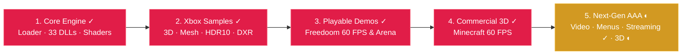
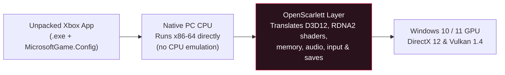
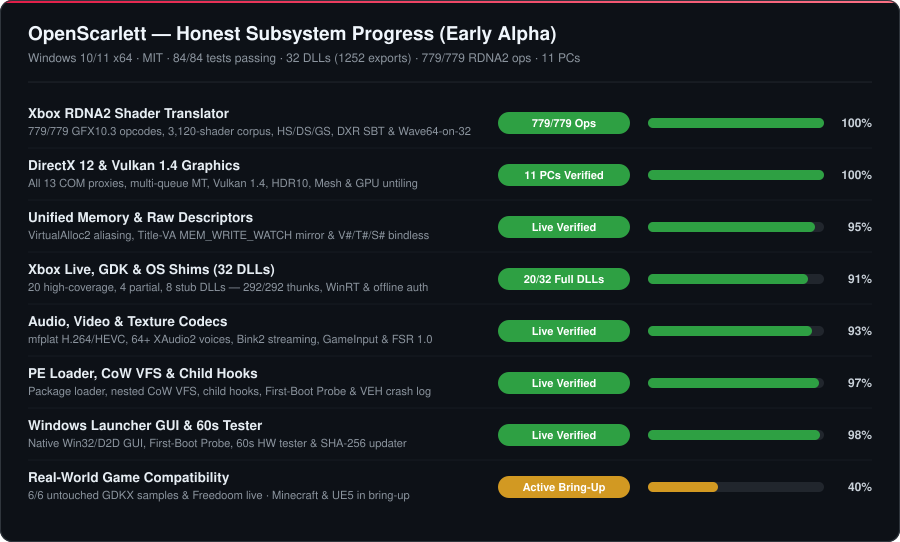
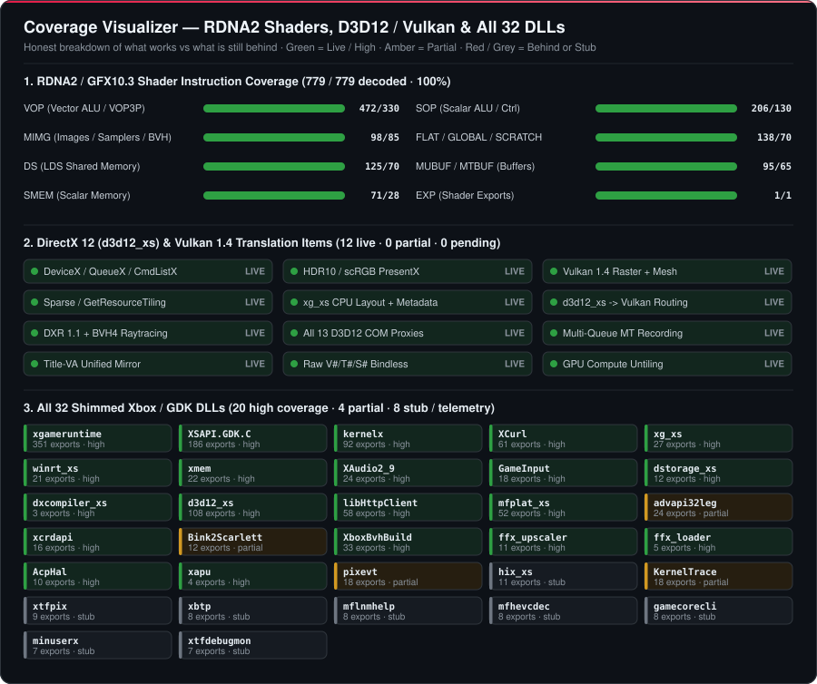

<p align="center">
  
</p>

<p align="center">
  <a href="https://github.com/californiaAlmonds/OpenScarlett/releases/latest"></a>
  <a href="https://discord.gg/sShMY2fjR"></a>
  <a href="https://github.com/californiaAlmonds/OpenScarlett/actions/workflows/ci.yml"></a>
  <a href="https://californiaalmonds.github.io/OpenScarlett/"></a>
  <a href="https://github.com/californiaAlmonds/OpenScarlett/wiki"></a>
  <a href="LICENSE"></a>
</p>

<p align="center">
  Because Xbox Series X|S uses an <strong>AMD x86-64 processor</strong> like a gaming PC, <strong>OpenScarlett</strong> runs game CPU code natively on Windows 10 &amp; 11 instead of emulating the CPU — translating only Xbox-specific graphics, RDNA2 shaders, audio, input, and OS calls to native <strong>DirectX 12</strong> &amp; <strong>Vulkan 1.4</strong>.
</p>

---

## Current Status

OpenScarlett is in **early alpha** (`v0.6.0-alpha`, **`90/90` automated tests**, **`33` shimmed DLLs / `1,372` PE exports**, **`0` stub-tier DLLs**). Commercial AAA titles beyond Minecraft are **not fully playable yet** — we are bringing them up step by step.

### Live-Tested vs. In Progress

| Track | Status | Verified Progress |
| :--- | :---: | :--- |
| **Minecraft Preview (`1.18.3064.0`)** | 🟢 **Live Playable (60 FPS)** | Boots, saves/loads `P:\` LevelDB worlds, and runs flicker-free 3D gameplay at **locked 60 FPS** (`12`-chunk render distance, `8×` AA, borderless fullscreen) on a 4 GB GTX 1650 Ti laptop (~14% CPU), with XInput-first polling, Raw Mouse + `F8` cursor-lock ([#41](https://github.com/californiaAlmonds/OpenScarlett/pull/41)), and depth-aware MSAA clamping. |
| **Retail GRDK `2504`/`2510` (RAGE9) Bring-Up** | 🟡 **Menus, Video & World Streaming Live** | Boots through **4K Bink2 intro video**, crisp scanline-free **Scaleform FTUE/Legal menus** (exact GFX10 `RbPlus` untiling, `v_cmpx` ramps, `XGameSave`), and razor-sharp **`BC7` loading splash screens** at 30–60 FPS on a 4 GB GTX 1650 Ti. Lifts live **`XDAT`/`XBCH`/`FSSM v5/v6`** graphics, compute & **Mesh/Amplification PSOs** (pruned to NVIDIA's 32 KiB limit) and streams **6.2+ GiB** via zero-syscall DirectStorage `RDS5` scatter transfers. **Next:** resolving the post-loading `XMemMapPhysicalPagesScatter` physical-page alias handoff into live 3D gameplay. |
| **GDK Samples, Demos & Dual-API Stack** | 🟢 **Live Verified** | **6/6 untouched MIT `_GAMING_XBOX_SCARLETT` samples** at 4K, 60 FPS **Freedoom: Phase 1** & **ScarlettArena**, dual-API (D3D12 + Vulkan 1.4) `gdk_3d_scene`, **`779/779` decoded (`775/779` real GPU-verified)** GFX10.3 RDNA2 opcodes across **3,120** corpus shaders (all 7 shader stages live GPU-verified), and verified across **15 NVIDIA & AMD PCs**. |



---

## How It Works



---

## Coverage Visualizer

Open the **[Interactive Dashboard](https://californiaalmonds.github.io/OpenScarlett/)** for live search & filters across subsystems, RDNA2 opcodes, and all 33 shimmed DLLs.





---

## Quick Start & 60s Hardware Test

No coding or SDK required to test your GPU or launch unpacked GDK binaries:

1. **[Download the latest `OpenScarlett-*-win64.zip`](https://github.com/californiaAlmonds/OpenScarlett/releases/latest)** and extract anywhere *(includes `OpenScarlettLauncher.exe` and open-source `dxc.exe`)*.
2. **Run `OpenScarlettLauncher.exe`** → open **60s Hardware Self-Test** → click **Run 60s Hardware Test** *(automatically strips usernames and local paths)*.
3. Share your sanitized hardware report or `--telemetry report.json` in **[Discord](https://discord.gg/sShMY2fjR)** or GitHub Issues — no game files ever need to be shared.

---

## Technical Details

<details>
<summary><strong>Subsystem &amp; 33-DLL Breakdown</strong></summary>
<br/>

<!-- OPENSCARLETT_STATUS_START -->
**Automated Tests:** `90/90` passing · **Shimmed DLLs:** `33` (`1372` PE exports) · **Shipping GDK Thunks:** `292/292` · **RDNA2 Opcodes Decoded:** `779/779` · **Validated Shader Corpus:** `3120/3120` · **Verified Hardware:** `15 PCs` (`NVIDIA` + `AMD`)

| Subsystem | Area | Status | Progress | Highlights |
| :--- | :--- | :---: | :---: | :--- |
| **RDNA2 / GFX10.3 Shader Lifter** | `Shaders` | 🟢 Live Verified | `100%` | `779/779` opcodes decoded (`775/779` real GPU-verified), `3,120/3,120` corpus shaders & all 7 stages (`CS/VS/PS/MS/AS/HS+DS/GS`) verified on DXIL SM 6.5/6.6 + SPIR-V; live retail `XDAT`/`XBCH`/`FSSM v5/v6` graphics, compute & mesh PSO lifting with 32 KiB output pruning and CRC32 disk cache. |
| **`d3d12_xs`, Vulkan 1.4 & `xg_xs`** | `Graphics` | 🟢 Live Verified | `100%` | All 13 Xbox COM proxies (Scarlett V4 `0x20004` vtables, `Slot_129` `DispatchMesh`), 256 MiB Tier-2 VA aliasing heap + L0 spill, exact GFX10 `RbPlus` texture untiling, async UMA readback ring, `>65,535` dispatch split, 16-bit RT stand-ins, live GPU `FMASK`/`DCC`/`HTILE` resolve, HDR10 `PresentX`, and direct Vulkan 1.4 routing. |
| **Unified Memory (`kernelx`/`xmem`) & DirectStorage** | `Memory & IO` | 🟢 Live Verified | `100%` | `VirtualAlloc2`/`MapViewOfFile3` 64 KiB & 4 MiB aliasing, placeholder splits, `__XMemAllocationHooks__`, `TitleVAMirror` 64 KiB dirty-hashing, and DirectStorage X2 with native `SRWLOCK` IOCP, cross-chunk `RDS5` decompression, and zero-syscall physical scatter transfers. |
| **GDK & Console Shims (33 DLLs)** | `GDK Shims` | 🟢 Live Verified | `100%` | `0` stub-tier DLLs (`30` High / `3` Partial): `xgameruntime` (`292/292` shipping thunks + GRDK `2504`/`2510` COM IIDs), `chad.dll`, `kernelx`, `winrt_xs`, `XCurl`, `XSAPI`, `GameInput` (XInput-first + Raw Mouse + `F8` cursor-lock), and stateful diagnostics/debug shims. |
| **Codecs, Audio & Video** | `Media` | 🟢 Live Verified | `100%` | Live 4K `Bink2Scarlett` GPU YUV→RGBA playback, `mfplat_xs`/`mfhevcdec`, 128-voice `XAudio2_9` + `AcpHal`/`xapu`/`chad`, BCPack BC1–BC7 + BC6H + TTPF, GDeflate v1, RDNA2 BVH4, Opus/XMA2/WASAPI, and FidelityFX 2.0 / FSR 1.0. |
| **PE32+ Loader, CoW VFS & Tools** | `Loader & UX` | 🟢 Live Verified | `100%` | Suspended-process APC hook loader with child-process propagation, `G:`/`T:`/`S:`/`P:` CoW VFS, Zen 2 VEH emulation (`CLWB`/`MONITORX`/`MWAITX`/`RDPRU`), `--probe-unknown-imports`, `OpenScarlettLauncher.exe`, and `os_live_profiler`. |
| **Real-World Title Compatibility** | `Compatibility` | 🟡 Partial | `50%` | **Live Playable (60 FPS):** Minecraft Preview (`1.18.3064.0`), Freedoom, ScarlettArena, 6/6 untouched MIT GDKX samples. **In Progress:** Retail GRDK `2504`/`2510` (RAGE9) — 4K Bink2 video, crisp FTUE/Legal menus, clean BC7 splash screens, and 6.2+ GiB world streaming live; finishing post-loading 3D world entry. |

<!-- OPENSCARLETT_STATUS_END -->

</details>

<details>
<summary><strong>Build From Source &amp; CLI Usage</strong></summary>
<br/>

### Requirements (Windows 10 / 11 x64)
- Windows 10 (1903+) or Windows 11 (x64)
- Visual Studio 2022 (MSVC C++20) + Windows 10/11 SDK (with `dxc.exe`)
- CMake 3.20+ and Ninja

### Build & Run Tests
```powershell
cmake -S . -B build -G Ninja -DCMAKE_BUILD_TYPE=Release
cmake --build build --parallel
ctest --test-dir build --output-on-failure
```

### Launcher & CLI
```powershell
# Native Win32/Direct2D GUI (Play & Launch, 60s Hardware Self-Test, PE Inspector, Updater)
.\build\OpenScarlettLauncher.exe

# Probe GPU capabilities (D3D12, DXR, Mesh Shaders, Vulkan, DXC)
.\build\openscarlett.exe probe-gpu

# Inspect x64 .exe / .dll imports & exports
.\build\openscarlett.exe inspect path\to\binary.exe

# Run an unpacked Xbox Series X|S package folder
.\build\openscarlett.exe run path\to\package_dir_or_game.exe --telemetry report.json
.\build\openscarlett.exe run --backend=vulkan path\to\package_dir_or_game.exe
```

</details>

---

## Community Hardware Reports

| GPU | Windows Build | Capabilities | Result | Reported By |
| :--- | :--- | :--- | :---: | :--- |
| **NVIDIA GeForce GTX 1650 Ti** (`4 GB`) | Win10 22H2 | `SM 6.5` · `Mesh` · `Vulkan 1.4` | 🟢 **90/90 Pass** | Maintainer |
| **NVIDIA GeForce MX250** (`4 GB`) | Win11 26H2 | `SM 6.6` · `MeshTier=0` | 🟡 **66/67** *(fix landed)* | [@GennyDotJson](https://github.com/GennyDotJson) ([#44](https://github.com/californiaAlmonds/OpenScarlett/issues/44)) |
| **NVIDIA GeForce RTX 2060 SUPER** (`8 GB`) | Win11 26H2 | `SM 6.6` · `Mesh` · `DXR=12` | 🟢 **13/13 Pass** | [@rpatty-dev](https://github.com/rpatty-dev) ([#1](https://github.com/californiaAlmonds/OpenScarlett/issues/1), [#8](https://github.com/californiaAlmonds/OpenScarlett/issues/8)) |
| **NVIDIA GeForce RTX 3060** (`12 GB`) | Win11 25H2 | `SM 6.6` · `Mesh` · `DXR=12` | 🟢 **67/67 Pass** | [@spoox009](https://github.com/spoox009) ([#34](https://github.com/californiaAlmonds/OpenScarlett/issues/34)) |
| **NVIDIA GeForce RTX 3080 Ti** (`12 GB`) | Win11 25H2 | `SM 6.6` · `Mesh` · `DXR=12` | 🟢 **13/13 Pass** | [@sackboysplayer](https://github.com/sackboysplayer) ([#13](https://github.com/californiaAlmonds/OpenScarlett/issues/13)) |
| **NVIDIA GeForce RTX 3090** (`24 GB`) | Win11 25H2 | `SM 6.6` · `Mesh` · `DXR=12` | 🟢 **67/67 Pass** | [@3090test](https://github.com/3090test) ([#47](https://github.com/californiaAlmonds/OpenScarlett/issues/47)) |
| **NVIDIA GeForce RTX 4060 Laptop** (`8 GB`) | Win11 25H2 | Ada · `DXR=12` | 🟢 **67/67 Pass** | [@LinZhongHu](https://github.com/LinZhongHu) ([#46](https://github.com/californiaAlmonds/OpenScarlett/issues/46)) |
| **NVIDIA GeForce RTX 4070 Laptop** (`8 GB`) | Win11 26H2 | `SM 6.7` · `Mesh` · `DXR=12` | 🟢 **67/67 Pass** | **Leon Redfish** *(Discord)* |
| **NVIDIA GeForce RTX 5060** (`8 GB`) | Win11 25H2 | `SM 6.6` · `Mesh` · `DXR=12` | 🟢 **67/67 Pass** | [@aidenhrld](https://github.com/aidenhrld) ([#31](https://github.com/californiaAlmonds/OpenScarlett/issues/31), [#41](https://github.com/californiaAlmonds/OpenScarlett/pull/41)) |
| **NVIDIA GeForce RTX 5070** (`12 GB`) | Win11 26H2 | `SM 6.6` · `Mesh` · `DXR=12` | 🟢 **62/62 Pass** | [@marquezinii](https://github.com/marquezinii) ([#17](https://github.com/californiaAlmonds/OpenScarlett/issues/17), [#26](https://github.com/californiaAlmonds/OpenScarlett/pull/26), [#40](https://github.com/californiaAlmonds/OpenScarlett/pull/40)) |
| **NVIDIA GeForce RTX 5080** (`16 GB`) | Win11 26H2 | `SM 6.6` · `Mesh` · `DXR=12` | 🟢 **67/67 Pass** | [@djsweatyfingerz](https://github.com/djsweatyfingerz) ([#45](https://github.com/californiaAlmonds/OpenScarlett/issues/45)) |
| **NVIDIA GeForce RTX 5090** (`32 GB`) | Win11 25H2 | `SM 6.6` · `Mesh` · `DXR=12` | 🟢 **67/67 Pass** | [@violet-dusk](https://github.com/violet-dusk) ([#36](https://github.com/californiaAlmonds/OpenScarlett/issues/36)) |
| **AMD Radeon RX 6750 XT** (`12 GB`) | Win11 25H2 | `Wave32..64` · `Mesh` · `DXR=11` | 🟡 **60/62** | [@Sootie1776](https://github.com/Sootie1776) ([#2](https://github.com/californiaAlmonds/OpenScarlett/issues/2#issuecomment-7082912023)) |
| **AMD Radeon 780M** (`6 GB` UMA) | Win11 25H2 | `SM 6.6` · `Mesh` · `DXR=11` | 🟡 **64/67** *(fix landed)* | [@violet-dusk](https://github.com/violet-dusk) ([#38](https://github.com/californiaAlmonds/OpenScarlett/issues/38)) |
| **AMD Radeon RX 7600** (`8 GB`) | Win11 26H2 | `SM 6.6` · `Mesh` · `DXR=11` | 🟢 **13/13 Pass** | [@AntoninMichelq](https://github.com/AntoninMichelq) ([#12](https://github.com/californiaAlmonds/OpenScarlett/issues/12)) |
| **AMD Radeon RX 7900 XTX** (`24 GB`) | Win11 26H2 | `SM 6.6` · `Mesh` · `DXR=11` | 🟢 **13/13 Pass** | [@wellgamer789](https://github.com/wellgamer789) ([#9](https://github.com/californiaAlmonds/OpenScarlett/issues/9)) |
| **AMD Radeon RX 9070 XT** (`16 GB`) | Win11 26H2 | `SM 6.6` · `Mesh` · `DXR=11` | 🟢 **67/67 Pass** | [@tatbkath](https://github.com/tatbkath) ([#30](https://github.com/californiaAlmonds/OpenScarlett/issues/30)), [@silentbay22](https://github.com/silentbay22) ([#10](https://github.com/californiaAlmonds/OpenScarlett/issues/10), [#27](https://github.com/californiaAlmonds/OpenScarlett/issues/27), [#29](https://github.com/californiaAlmonds/OpenScarlett/issues/29)) |
| **Intel Arc B390** *(Battlemage)* | Win11 26H2 | `SM 6.6` · `Mesh` · `DXR=11` | 🟡 **60/67** *(fixes landed)* | [@lovexyzforever](https://github.com/lovexyzforever) ([#33](https://github.com/californiaAlmonds/OpenScarlett/issues/33)) |

Thanks to all contributors and hardware testers! Contributions and bug reports are welcome — see [CONTRIBUTING.md](CONTRIBUTING.md). Licensed under **[MIT](LICENSE)**.
