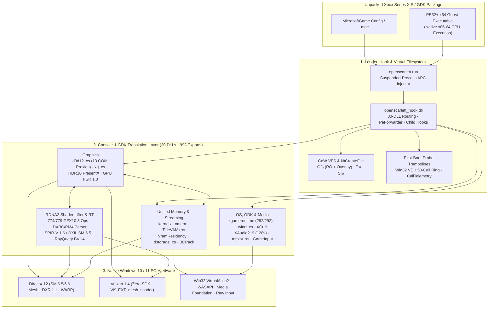

# Architecture Overview

OpenScarlett is a **native compatibility and API translation layer** — not a CPU emulator. Because Xbox Series X|S (Scarlett / Gen9) uses an **AMD Zen 2 x86-64 processor** and a Windows-derived Game Core PE32+ executable ABI, guest CPU instructions execute directly on the host Windows 10/11 x64 CPU at native speed.

---

## High-Level Pipeline

---

## Core Design Principles

1. **Zero Guest Directory Pollution:** Standalone GDK binaries execute inside their original directory with **zero shim DLLs copied next to the `.exe`**. `openscarlett.exe run` creates the guest process in a `CREATE_SUSPENDED` state, injects `openscarlett_hook.dll` via APC before the guest entrypoint executes, and transparently redirects all 30 console/GDK DLL imports to OpenScarlett's shim directory.
2. **Real Binaries & Live GPU Verification:** Every subsystem is validated against real compiled workloads — untouched MIT Microsoft `Xbox-GDK-Samples`, live shipping GDK thunks (`XGamingRuntimeThunks.dll`), playable demos (*Freedoom: Phase 1*, *ScarlettArena*), dual-API 3D scenes, and a 3,120-shader GFX10.3 corpus checked by `spirv-val`, `dxc.exe`, real NVIDIA/AMD GPUs, and D3D12 WARP.
3. **Dual-API Graphics Routing:** `d3d12_xs.dll` can drive native **DirectX 12** (default) or route command lists directly onto OpenScarlett's zero-SDK **Vulkan 1.4** backend (`--backend=vulkan`) with `VK_EXT_mesh_shader` and sparse tile support.
4. **Hardware-Agnostic Fallbacks:** Features unavailable on older PC GPUs degrade gracefully without crashing:
   - **DXR Tier 1.1 (`DXR=0` GPUs like GTX 1650 Ti):** Transparent fallback to GPU compute BVH4 traversal / SAH `XboxBvhBuilder` (`test_dxr_live`, `test_s12_rayquery_live`).
   - **Wave64 Shaders on Wave32 GPUs (NVIDIA Turing/Ampere/Ada/Blackwell):** Exact cross-half **Wave64-on-Wave32** emulation (`448/448` dwords verified across GTX 1650 Ti, WARP, and Vulkan).
   - **HDR10 on SDR Displays:** Automatic ST.2084 / scRGB detection with ACES + Reinhard SDR tonemapping fallback.
   - **Headless / CI Systems:** D3D12 WARP software rasterizer + `OPENSCARLETT_AUDIO_NULL=1` null WASAPI sink + headless `mfplat_xs` decode fallback.
5. **Strict Portable Storage & Privacy:** All writable VFS directories (`G:` CoW overlay, `T:`, `S:`), shader caches, and telemetry reports default to portable workspace-relative paths (never leaking to `C:\`). Telemetry and hardware reports automatically strip Windows usernames and local directory paths.

---

## Source Tree Layout

| Path | Responsibility |
| :--- | :--- |
| `src/main.cpp` | `openscarlett.exe` CLI entry point (`probe-gpu`, `probe`, `inspect`, `rdna2-bench`, `run`) |
| `src/core/` | Common status types (`status.cpp`) and unified `CallTelemetry` logger (`telemetry.cpp`) |
| `src/loader/` | PE32+ inspector, APC injector, `openscarlett_hook.dll`, `PeForwarder`, `MicrosoftGame.Config` parser, 12 KiB XVD inspector, CoW VFS, First-Boot Probe + VEH |
| `src/kernel/` | `xmemory.cpp` (`VirtualAlloc2` aliasing), `gpu_tile_pool.cpp`, `title_va_mirror.cpp` (`MEM_WRITE_WATCH`), `vram_residency_manager.cpp`, `console_lsa_policy.cpp` |
| `src/gpu/d3d12_xs/` | All 13 Xbox COM proxies (`DeviceX`, `CommandQueueX`, `CommandListX`, `proxies_x`), `sampler_feedback_x`, `query_accumulator_x` |
| `src/gpu/` | RDNA2/GFX10.3 disassemblers & ISA tables, SSA IR, Xbox DXBC/PM4/SGPR container parser, SPIR-V & DXIL lifters, `rdna2_rayquery_bridge`, `rdna2_stages_ext`, `descriptor_sgpr_bridge`, `shader_cache`, `vulkan_backend`, `xg_layout`, `xg_gpu_untile`, `dxr_hardware`, `bvh4_decoder`, `rt_bvh`, `frame_capture` |
| `src/io/` | `gdeflate.cpp` (GDeflate v1) and `bcpack.cpp` (BCPack BC1–BC7 + texture arrays) |
| `src/audio/` | `xma2_decoder.cpp` (XMA2 IMDCT) and `opus_adpcm_decoder.cpp` (`MSOpusDecoder` + ADPCM) |
| `src/middleware/` | `bink2_decoder.cpp` (KB2i DCT multi-frame decode) |
| `src/shims/` | All 30 exported Windows PE shim DLLs (`d3d12_xs`, `xg_xs`, `kernelx`, `xmem`, `xgameruntime`, `winrt_xs`, `XAudio2_9`, `GameInput`, `dstorage_xs`, `mfplat_xs`, `XCurl`, `XSAPI`, etc.) |
| `src/launcher/` | Native Win32/Direct2D `OpenScarlettLauncher.exe` GUI, 60s hardware test runner, PE inspector bridge, and BCrypt SHA-256 updater |
| `include/openscarlett/` | Public headers and ABI structs for every subsystem |
| `tests/` | 62 automated CTest suites, GDK samples, untouched Microsoft `Xbox-GDK-Samples`, *Freedoom*/*ScarlettArena*, and dual-API `gdk_3d_scene` |
| `tools/` | `generate_status.py`, `rdna2_corpus_bench.py`, `run_hardware_test.ps1` / `.bat`, `publish_wiki.ps1` |

---

## Subsystem Deep Dives
- [Loader & Virtual Filesystem](Loader-and-VFS.md)
- [Graphics: DirectX 12 (`d3d12_xs`) & Vulkan 1.4](Graphics-D3D12-and-Vulkan.md)
- [RDNA2 Shader Lifter & Ray Tracing](RDNA2-Shader-Lifter-and-Raytracing.md)
- [Memory, Streaming & Storage](Memory-Streaming-and-Storage.md)
- [Audio, Video & Input](Audio-Video-and-Input.md)
- [System DLL Shims Reference (30 DLLs)](System-DLL-Shims-Reference.md)
