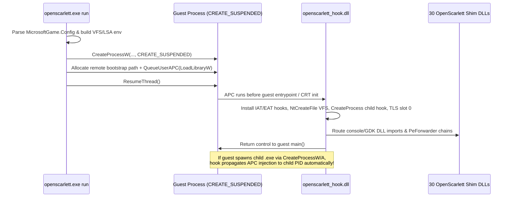

# Loader & Virtual Filesystem (VFS)

OpenScarlett's loader launches unpacked Xbox Series X|S / GDK packages directly on Windows x64 without modifying guest executables or copying shim DLLs into the game directory.

---

## 1. Suspended-Process APC Injection & Child-Hook Propagation

Source: [`src/loader/apc_injector.cpp`](https://github.com/californiaAlmonds/OpenScarlett/blob/main/src/loader/apc_injector.cpp), [`src/loader/hook_dll.cpp`](https://github.com/californiaAlmonds/OpenScarlett/blob/main/src/loader/hook_dll.cpp)

### Key Loader Capabilities
- **30-DLL Routing Table (`DllRoutingTable`):** Redirects console and GDK DLL loads to OpenScarlett's shim directory while keeping **`System32`-first `KnownDLL` resolution** for genuine Windows OS DLLs. Supports runtime overrides via `OPENSCARLETT_DLL_ROUTING`.
- **Child-Process Hook Propagation:** Hooks `CreateProcessW` and `CreateProcessA` inside the guest so multi-process launchers (verified live on real multi-process UE/Unity launchers such as *Pizza House Simulator* and 3-generation *House Flipper 2* child trees) automatically receive `openscarlett_hook.dll` with per-PID telemetry (`OPENSCARLETT_CHILD_TELEMETRY_PER_PID`).
- **Kahn Topological DLL Initialization:** Resolves inter-DLL dependency graphs deterministically in topological order (`test_gdk_extended_loader`).
- **TLS Slot 0 Console State:** Initializes and manages Thread-Local Storage slot 0 state (`OPENSCARLETT_TLS_SLOT0_STATE`) for console runtime/CRT expectations (`test_s12_os_loader_gameinput`).
- **PE Validation Hardening:** Handles RVA-0 relocation entries, bounded export name scanning, fault-free section protection transitions, and `.xdata` `UWOP_ALLOC_LARGE` + version 2/3 chained SEH unwind records (`test_s7_pe_gdk_runtime`).
- **Store Bootstrapper Diagnostics:** Detects when a user accidentally launches a Microsoft Store / Gaming Services bootstrapper stub rather than the unpacked game binary and prints an actionable diagnostic.

---

## 2. PE Forwarder & Mixed-Case API-Set Resolution

Source: [`include/openscarlett/loader/pe_forwarder.h`](https://github.com/californiaAlmonds/OpenScarlett/blob/main/include/openscarlett/loader/pe_forwarder.h), [`src/loader/pe_forwarder.cpp`](https://github.com/californiaAlmonds/OpenScarlett/blob/main/src/loader/pe_forwarder.cpp)

Xbox and Windows GDK binaries frequently import symbols that forward across mixed-case DLL names, ordinal exports, and `api-ms-win-*` / `ext-ms-win-*` API-Set contracts. `PeForwarderResolver` provides:
- Case-normalized DLL stem parsing while preserving exact export symbol case (or `#ordinal` references).
- Recursive forwarder chain resolution with cycle detection (`CycleError`) and depth-limit guards (`DepthLimitError`).
- Classification of every import into `OpenScarlettShim`, `WindowsSystemDll`, `ApiSetRedirected`, `NativeGuestDll`, or `Unresolved`.
- Preflight reporting via `openscarlett probe <exe|dir|xvd> [--json]` (`ready_to_launch` boolean + full chain breakdown).

---

## 3. Package Config (`MicrosoftGame.Config`) & `ConsoleLsaPolicy`

Source: [`src/loader/game_config.cpp`](https://github.com/californiaAlmonds/OpenScarlett/blob/main/src/loader/game_config.cpp), [`src/kernel/console_lsa_policy.cpp`](https://github.com/californiaAlmonds/OpenScarlett/blob/main/src/kernel/console_lsa_policy.cpp)

When pointed at a package directory or `.mgc` / `MicrosoftGame.Config` XML file, OpenScarlett automatically resolves:
- Target executable path (`ExecutableList`), display name, and working directory
- `Identity` (`Name`, `Publisher`, `Version`) → deterministic **Package Family Name (PFN)** derivation
- `TitleId` (hex), `MSAAppId`, `StoreId`, and `SandboxId`
- Console Local Security Authority (LSA) identity & offline profile policies consumed by `xgameruntime.dll`, `XCurl.dll`, and `XSAPI`

---

## 4. 12 KiB XVD / XVC Header Inspector

Source: [`include/openscarlett/loader/xvd_inspector.h`](https://github.com/californiaAlmonds/OpenScarlett/blob/main/include/openscarlett/loader/xvd_inspector.h), [`src/loader/xvd_inspector.cpp`](https://github.com/californiaAlmonds/OpenScarlett/blob/main/src/loader/xvd_inspector.cpp)

`openscarlett probe <file.xvd|file.xvc>` performs **strictly read-only metadata inspection** of the public 12 KiB (`0x3000` byte) Xbox Virtual Disk header (`msft-xvd` magic at offset `0x200`):
- Reports disk type (`Fixed`/`Dynamic`), content type (`Title`, `Data`, `Application`, etc.), drive size, page/block geometry (`4 KiB` pages, `680 KiB` default block), format version, sandbox ID, product ID, package version, and XVC region descriptors.
- Detects whether encryption flags / ODK keyslots are active (`is_encrypted`).
- Encrypted containers report `ready_to_launch: false` during preflight.

---

## 5. Virtual Filesystem (`G:\`, `T:\`, `S:\`) & Copy-on-Write Overlay

Source: [`include/openscarlett/loader/vfs_mounts.h`](https://github.com/californiaAlmonds/OpenScarlett/blob/main/include/openscarlett/loader/vfs_mounts.h), [`src/loader/vfs_mounts.cpp`](https://github.com/californiaAlmonds/OpenScarlett/blob/main/src/loader/vfs_mounts.cpp)

Xbox Series X|S titles expect fixed console drive letters. OpenScarlett intercepts both Win32 (`CreateFileW/A`, `GetFileAttributes*`, `FindFirstFile*`, `DeleteFile*`, `MoveFile*`) and Native NT (`NtCreateFile` / `NtOpenFile`) path APIs and maps them safely onto host directories:

| Virtual Drive | Console Role | Host Behavior | Override Flag / Env Var |
| :--- | :--- | :--- | :--- |
| **`G:\`** / **`GAME:\`** | Read-only game package root | **Strictly read-only base**; writes redirect transparently to a **Copy-on-Write (CoW) overlay** with whiteout deletion tracking so original game files are never modified. Supports nested read-only sub-mounts (e.g., `G:\DLC\Pack1`) via `OPENSCARLETT_VFS_G_SUBMOUNTS`. | `--vfs-g`, `--vfs-g-overlay` / `OPENSCARLETT_VFS_G`, `OPENSCARLETT_VFS_G_OVERLAY` |
| **`T:\`** | Title scratch / temporary cache | Writable per-title scratch directory | `--vfs-t` / `OPENSCARLETT_VFS_T` |
| **`S:\`** | Persistent user save data (`XGameSave`) | Persistent save root directory | `--vfs-s` / `OPENSCARLETT_VFS_S`, `OPENSCARLETT_SAVE_ROOT` |

### Safety & Isolation Guarantees
- **Path Traversal Protection:** Any `..` escape attempt above a mount root returns `VfsTranslateStatus::RejectedTraversal`.
- **Zero `C:\` Leakage:** `ResolveDefaultWorkDirW()` resolves writable VFS and telemetry roots relative to `OPENSCARLETT_WORK_DIR` or the executable directory (`.tmp/openscarlett_run` or `.openscarlett_tmp`), falling back to `%TEMP%` only if the launch directory is read-only. Setting `OPENSCARLETT_FORBID_SYSTEM_DRIVE_WRITES=1` actively rejects mutating operations targeting `C:\` / `%SystemDrive%`.

---

## 6. First-Boot Probe Mode & VEH Crash Diagnostics

Source: [`include/openscarlett/loader/probe_veh.h`](https://github.com/californiaAlmonds/OpenScarlett/blob/main/include/openscarlett/loader/probe_veh.h), [`src/loader/probe_veh.cpp`](https://github.com/californiaAlmonds/OpenScarlett/blob/main/src/loader/probe_veh.cpp)

When bringing up a brand-new binary for the first time, launch with `--probe-unknown-imports` (or enable **First-Boot Probe Mode** in `OpenScarlettLauncher.exe`):
1. **Dynamic x64 `E_NOTIMPL` Trampoline Pool:** Any unresolved import from a shimmed or missing DLL is bound to a dynamically generated x64 stub that logs the exact `module!symbol` call to `CallTelemetry` and returns `E_NOTIMPL` cleanly instead of crashing at load time.
2. **Win32 Vectored Exception Handler (VEH):** Captures unhandled exceptions with register state, faulting module/offset, and a **50-call API ring buffer** showing the last 50 shimmed calls leading up to the fault — with all local paths and usernames sanitized for safe sharing.

---

## Related Pages
- [Architecture Overview](Architecture-Overview.md)
- [System DLL Shims Reference (30 DLLs)](System-DLL-Shims-Reference.md)
- [CLI, Environment Variables & Diagnostics](CLI-Environment-and-Diagnostics.md)
