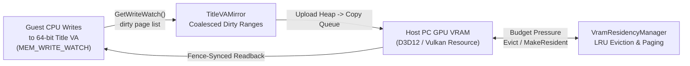

# Memory, Streaming & Storage

Xbox Series X|S uses a **16 GB unified GDDR6 memory architecture** with direct physical page aliasing, hardware **DirectStorage**, **BCPack** GPU texture decompression, and **GDeflate**. Desktop PCs split system RAM and GPU VRAM across PCIe — OpenScarlett bridges this architectural gap cleanly using modern Windows 10/11 virtual memory primitives and GPU-coherent mirroring.

---

## 1. Unified Memory & Physical Page Aliasing (`kernelx.dll` / `xmem.dll`)

Source: `src/kernel/xmemory.cpp`, `src/kernel/gpu_tile_pool.cpp`, `src/shims/kernelx_shim.cpp`, `src/shims/xmem_shim.cpp`

- **64 KiB & 4 MiB Physical Page Aliasing:** Uses Windows 10/11 **`VirtualAlloc2`**, **`CreateFileMapping2`**, and **`MapViewOfFile3`** placeholder splitting/coalescing to emulate Xbox `VirtualAlloc` / `MapTitleEsramPages` / `AllocateTitlePhysicalPages` where multiple virtual address ranges alias the exact same physical pages with independent page protections (`test_kernelx`, `test_s12_streaming_vram`).
- **`GpuTilePool`:** Manages virtual 64 KiB GPU tiles for D3D12 reserved/tiled resources and Vulkan sparse memory bindings.
- **`XMemAlloc` / `XMemVirtualQuery` & ERA Attributes (`xmem.dll`):** Preserves console allocation attributes (alignment, memory type, allocator ID) and query metadata expected by Unreal Engine, Unity, and custom AAA allocators (`test_s7_pe_gdk_runtime`).
- **7-Core / 14-Thread Console CPU Topology (`kernelx.dll`):** Remaps Xbox Series X|S title-accessible core masks (7 cores / 14 hardware threads reserved for titles on console) cleanly onto arbitrary host PC CPU topologies (`test_os_winrt_offline_auth`).

---

## 2. 64-Bit `TitleVAMirror` & LRU `VramResidencyManager`

Source: [`include/openscarlett/kernel/title_va_mirror.h`](https://github.com/californiaAlmonds/OpenScarlett/blob/main/include/openscarlett/kernel/title_va_mirror.h), `src/kernel/title_va_mirror.cpp`, [`include/openscarlett/kernel/vram_residency_manager.h`](https://github.com/californiaAlmonds/OpenScarlett/blob/main/include/openscarlett/kernel/vram_residency_manager.h), `src/kernel/vram_residency_manager.cpp`

- **`TitleVAMirror` (`MEM_WRITE_WATCH`):** On Xbox, CPU and GPU share the same unified 64-bit virtual address space. `TitleVAMirror` backs guest CPU-visible unified allocations with `MEM_WRITE_WATCH`, queries modified pages via `GetWriteWatch()`, flushes only dirty ranges to host GPU VRAM prior to command list execution, and performs fence-synced GPU-to-CPU readbacks when the title inspects GPU-written data (`test_unified_mem_bindless`, `test_s12_streaming_vram`).
- **LRU `VramResidencyManager`:** Because many PC GPUs have 4–8 GB of dedicated VRAM (compared to 13.5 GB title-accessible GDDR6 on Series X), `VramResidencyManager` monitors DXGI memory budgets, tracks per-allocation last-used fence values, evicts cold allocations safely to host RAM backing stores, and transparently re-uploads pages before GPU use (`test_s12_streaming_vram`).

---

## 3. DirectStorage (`dstorage_xs.dll` / `xcrdapi.dll`)

Source: [`include/openscarlett/io/dstorage_abi.h`](https://github.com/californiaAlmonds/OpenScarlett/blob/main/include/openscarlett/io/dstorage_abi.h), `src/shims/dstorage_shim.cpp`, `src/shims/xcrdapi_shim.cpp`

OpenScarlett's DirectStorage implementation passes the untouched Microsoft MIT **`SimpleDirectStorageCombo`** sample (`SimpleLoad`, `StatusBatch`, `CompletionEvent`, `MultipleQueues` — byte-identical hash `0x6824D2954256492C` across 769 live calls) and adds full Sprint 12 AAA streaming capabilities:

- **Strict Priority Scheduling:** Dispatches queues in strict priority order (`REALTIME` > `HIGH` > `NORMAL` > `LOW`) with telemetry counters (`OpenScarlettDStorageGetPriorityStats`).
- **Request Cancellation & Physical-Page Targets:** Supports in-flight cancellation tags and direct decompression into physical-page-aliased memory targets.
- **Custom Decompression Callbacks:** `OpenScarlettDStorageRegisterCustomDecompressor` / `UnregisterCustomDecompressor` (`IDStorageCustomDecompressionQueue`-style) for title-specific codecs (`OS_DSTORAGE_CUSTOM_COMPRESSION_0 = 0x80+`).
- **Direct GPU Texture Upload + Automatic Untiling (`OpenScarlettDStorageTextureDestDesc`):** Decompresses GDeflate / BCPack streams and automatically routes tiled textures (`src_tile_mode != 0`) through **`XgGpuUntiler`** (`cs_6_5` GPU compute untiling + `HTILE`/`DCC`/`CMASK` coherency) straight into `D3D12_HEAP_TYPE_DEFAULT` textures (`test_s12_streaming_vram`).

---

## 4. Compression Codecs: GDeflate v1 & BCPack BC1–BC7

Source: `src/io/gdeflate.cpp`, `src/io/bcpack.cpp`

| Codec | Format & Capabilities | Verification |
| :--- | :--- | :--- |
| **GDeflate v1** | Tile-parallel RFC 1951/Deflate stream decompression matching Xbox/DirectStorage GDeflate v1 tile headers | `test_codecs`, `test_xg_dstorage`, `test_external_gdk_bringup` |
| **BCPack (BC1–BC7)** | Block-compressed texture decompression for **BC1, BC2, BC3, BC4, BC5, BC6H, and BC7**, plus Sprint 12 **texture-array (`BCPA` magic, up to 2,048 slices) & multi-mip** streaming validation | `test_bcpack_bvh4`, `test_s12_streaming_vram` |

---

## Related Pages
- [Graphics: DirectX 12 (`d3d12_xs`) & Vulkan 1.4](Graphics-D3D12-and-Vulkan.md)
- [Loader & Virtual Filesystem](Loader-and-VFS.md)
- [System DLL Shims Reference (30 DLLs)](System-DLL-Shims-Reference.md)
