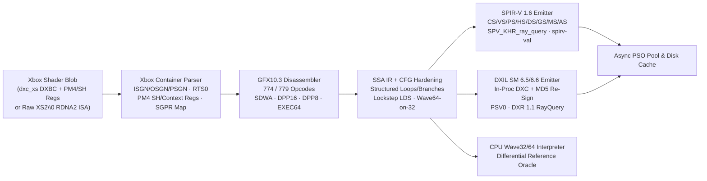

# RDNA2 Shader Lifter & Ray Tracing

Xbox Series X|S titles ship pre-compiled **AMD RDNA2 / GFX10.3** GPU machine code (compiled by Xbox `dxc_xs`) rather than portable PC DXIL bytecode. OpenScarlett contains an RDNA2 shader pipeline that parses Xbox shader containers, disassembles GFX10.3 machine code into SSA IR, lifts it to **SPIR-V 1.6** and **DXIL SM 6.5/6.6**, and caches compiled PC pipelines to disk.

---

## End-to-End Shader Lifting Pipeline

---

## 1. GFX10.3 / RDNA2 ISA Coverage (`774 / 779` Opcodes)

Measured live from [`docs/rdna2_coverage.json`](https://github.com/californiaAlmonds/OpenScarlett/blob/main/docs/rdna2_coverage.json) via `openscarlett rdna2-bench --full`:

- **Total GFX10.3 ISA Opcodes Audited:** `779`
- **Decoded, Lifted (SPIR-V + DXIL) & CPU-Referenced:** **`774 / 779` (`99.4%`)**
- **Real-GPU Differential Verified:** **`615 / 779` (`78.9%`)** (live execution parity across NVIDIA GTX 1650 Ti D3D12, Vulkan 1.4.329, and D3D12 WARP, including 4 GFX10.3 hardware accuracy rules in `test_rdna2_gpu_accuracy`)

| ISA Family | Category | Total | Decoded / Lifted / CPU-Ref | Real-GPU Verified |
| :--- | :--- | :-: | :-: | :-: |
| **`SOP1`** | Scalar 1-source ALU & `s_and_saveexec_b64` | 58 | **58 / 58** | 28 |
| **`SOP2`** | Scalar 2-source ALU & 64-bit EXEC masks | 43 | **43 / 43** | 42 |
| **`SOPK`** | Scalar immediate-constant ops | 27 | **27 / 27** | 21 |
| **`SOPC`** | Scalar comparisons (`SCC`) | 18 | **18 / 18** | 18 |
| **`SOPP`** | Branches, `s_barrier`, `s_waitcnt`, `s_sendmsg` | 39 | **39 / 39** | 20 |
| **`SMEM`** | Scalar memory & buffer loads/atomics | 20 | **16 / 20** | 12 |
| **`VOP1`** | Vector 1-source ALU & conversions (`v_cvt_*`) | 74 | **74 / 74** | 53 |
| **`VOP2`** | Vector 2-source ALU (incl. `SDWA`/`DPP16`/`DPP8`) | 50 | **49 / 50** | 49 |
| **`VOPC`** | Vector comparisons & `v_cmpx_*` | 108 | **108 / 108** | 55 |
| **`VOP3`** | 3-source vector ALU, `v_bfe`, `v_permlane16/x16` | 82 | **82 / 82** | 65 |
| **`VOP3P`** | Packed 16-bit (`f16`/`i16`) dot & dual-ALU | 24 | **24 / 24** | 24 |
| **`VINTRP`** | Pixel shader barycentric attribute interpolation | 6 | **6 / 6** | 6 |
| **`MUBUF`** | Untyped buffer load/store/atomics | 46 | **46 / 46** | 45 |
| **`MTBUF`** | Typed vertex/buffer fetch (`d16` packed formats) | 16 | **16 / 16** | 16 |
| **`MIMG`** | 1D/2D/3D/Cube/Array/MSAA textures + `image_bvh*_intersect_ray` | 42 | **42 / 42** | 42 |
| **`DS`** | Local Data Share (LDS) load/store/atomics/swizzle | 54 | **54 / 54** | 48 |
| **`FLAT`** | Unified flat 64-bit memory ops | 24 | **24 / 24** | 24 |
| **`GLOBAL`** | Global 64-bit memory load/store/atomics | 28 | **28 / 28** | 27 |
| **`SCRATCH`** | Per-lane register spilling to scratch memory | 19 | **19 / 19** | 19 |
| **`EXP`** | Color/depth/pos/param shader exports | 1 | **1 / 1** | 1 |
| **TOTAL** | **All 20 GFX10.3 Families** | **779** | **774 / 779 (99.4%)** | **615 / 779 (78.9%)** |

---

## 2. Xbox `dxc_xs` Container Parser & CFG Hardening

Source: [`include/openscarlett/gpu/rdna2_xbox_container.h`](https://github.com/californiaAlmonds/OpenScarlett/blob/main/include/openscarlett/gpu/rdna2_xbox_container.h), [`src/gpu/rdna2_xbox_container.cpp`](https://github.com/californiaAlmonds/OpenScarlett/blob/main/src/gpu/rdna2_xbox_container.cpp), [`src/gpu/rdna2_ir.cpp`](https://github.com/californiaAlmonds/OpenScarlett/blob/main/src/gpu/rdna2_ir.cpp)

- **DXBC / `dxc_xs` Container Parsing:** Validates MD5 container digests, parses `ISGN`/`OSGN`/`PSGN` shader I/O signatures and `RTS0` embedded root signatures, and extracts PM4 Type-3 `IT_SET_SH_REG` / `IT_SET_CONTEXT_REG` packets (`SPI_SHADER_PGM_RSRC1/2/3_*`, `COMPUTE_NUM_THREAD_X/Y/Z`, `SPI_PS_INPUT_CNTL_0..31`, `SPI_PS_INPUT_ENA`, `PA_CL_VS_OUT_CNTL`).
- **CFG Hardening:** Reconstructs structured `if`/`else`/loop control flow directly from GFX10.3 64-bit/32-bit EXEC-mask idioms (`s_and_saveexec_b64`, `s_or_b64`, `s_xor_b64`, `s_andn2_b64`, `s_cbranch_execz`, `s_cbranch_scc*`).
- **All Shader Stages Supported:**
  - Compute (`CS`), Vertex (`VS`), Pixel (`PS`)
  - Hull (`HS`), Domain (`DS`), Geometry (`GS`) — `src/gpu/rdna2_stages_ext.cpp`
  - Mesh (`MS`, `MeshEXT`, `GS_ALLOC_REQ`, `merged_wave_info`, `CullPrimitiveEXT`, `CullDistance`)
  - Amplification / Task (`AS`, SPIR-V 1.6 `TaskEXT`, `130/130` `spirv-val` passing in `test_rdna2_as_task_spirv`)
- **Hardware Quirks Handled Automatically:**
  - **Exact Cross-Half Wave64-on-Wave32 Emulation:** Emulates RDNA2 64-lane `ballot`, `mbcnt`, `readfirstlane`, `permlane16`/`permlanex16`, and LDS cross-half reductions on 32-lane NVIDIA GPUs (`448/448` dwords verified on GTX 1650 Ti, WARP, and Vulkan).
  - **Lockstep 1-Wave LDS Barriers:** Honors `PSV0` `NumThreads` so single-wave shaders relying on RDNA2 lockstep LDS execution never race on host GPUs (`test_rdna2_lockstep_isa`).
  - **Raw `V#`/`T#`/`S#` & Root-SGPR `s0..s15` Bindless Bridge (`src/gpu/descriptor_sgpr_bridge.cpp`):** Translates console raw resource descriptors and root SGPR tables to D3D12 SM 6.6 `ResourceDescriptorHeap[]` / `SamplerDescriptorHeap[]` and Vulkan `VK_EXT_descriptor_indexing`.
  - **DXIL MD5 Re-Signing & `PSV0`:** Re-signs lifted DXIL blobs with valid DXBC MD5 hashes and updates `PSV0` wave-size bounds so retail D3D12 drivers accept them without Developer Mode.
  - **In-Process DXC & Async PSO Disk Cache (`src/gpu/shader_cache.cpp`):** Uses in-process `dxcompiler.dll` compilation with background async PSO pre-compilation (`OPENSCARLETT_ASYNC_PSO`) and content-addressed disk caching (`OPENSCARLETT_SHADER_CACHE`).

---

## 3. 3,120-Shader AAA Validation Corpus

Run `openscarlett rdna2-bench --full --json docs/rdna2_coverage.json` to validate **3,120 unique shaders** across **5 stages** (`2,080 CS`, `260 VS`, `520 PS`, `130 MS`, `130 AS`) and **12 realistic AAA workloads** (`260` shaders each):

1. `pbr_ibl` — PBR/IBL GGX/Fresnel microfacet shading (`PS VINTRP` + `CS`)
2. `cascaded_shadows` — Cascaded shadow maps & PCF depth filtering (`PS` + `CS`)
3. `deferred_gbuffer` — Deferred G-buffer `f16`/`snorm16`/`unorm16` pack & unpack (`CS` + `PS`)
4. `skeletal_skinning` — Bone matrix palette skinning & `MTBUF D16` vertex fetch (`VS` + `CS`)
5. `meshlet_culling` — `AS` + `MS` frustum/cone culling, `GS_ALLOC_REQ` & `merged_wave_info`
6. `clustered_tiled_lighting` — Tiled/clustered light culling with LDS & root constants (`CS`)
7. `postfx_bloom_tonemap_fsr_taa` — Bloom, ACES tonemap, FSR 1.0 & TAA history clamp (`CS` + `PS`)
8. `bvh4_ray_traversal` — BVH4 ray-box & ray-triangle traversal via `image_bvh_intersect_ray` (`CS`)
9. `lds_prefix_sum_radix_sort` — LDS workgroup prefix-sum & radix sort with lockstep barriers (`CS`)
10. `wave32_wave64_ballot_permlane` — Wave32/Wave64 ballot, `mbcnt`, `readfirstlane`, `permlane16/x16` (`CS`)
11. `texture_2d_3d_cube_mip_gather_atomics` — 2D/3D/Cube mip load, explicit LOD sample, store & `cmpswap` (`CS`)
12. `scratch_register_spilling` — `SCRATCH` spilling, scalar loops, `GLOBAL`/`FLAT` & 16-bit integer ALU (`CS` + `VS`)

**Latest Measured Result:** `3,120 / 3,120` passed (`100%`), `432 / 432` external `spirv-val` + `dxc` SM 6.5 MD5 re-signed, live execution verified on GTX 1650 Ti (D3D12 + Vulkan 1.4) and WARP in ~27.4 seconds.

---

## 4. Ray Tracing: RDNA2 RayQuery Bridge, 64-Bit BVH4 & DXR 1.1

Source: [`include/openscarlett/gpu/rdna2_rayquery_bridge.h`](https://github.com/californiaAlmonds/OpenScarlett/blob/main/include/openscarlett/gpu/rdna2_rayquery_bridge.h), `src/gpu/rdna2_rayquery_bridge.cpp`, `src/gpu/dxr_hardware.cpp`, `src/gpu/bvh4_decoder.cpp`, `src/gpu/rt_bvh.cpp`, `src/shims/xbox_bvh_builder_shim.cpp`

Xbox Series X|S executes inline raytracing using GFX10.3 `image_bvh_intersect_ray` (32-bit node pointers) and `image_bvh64_intersect_ray` (64-bit node pointers) over AMD **BVH4** acceleration structures. OpenScarlett translates these cleanly across every GPU tier:

- **Three Simultaneous Translation Targets (`TranslateRdna2BvhIntersectToRayQuery`):**
  1. **DXR Tier 1.1 HLSL (`cs_6_5`):** Native `RayQuery<RAY_FLAG_*>` (`TraceRayInline`, `Proceed`, `CommittedStatus`, `CommittedTriangleBarycentrics`, `CommittedPrimitiveIndex`, `CommittedInstanceID`) for hardware RT-core GPUs (RTX 20/30/40/50, RX 6000/7000/9000).
  2. **Vulkan `SPV_KHR_ray_query` SPIR-V 1.4:** Validated cleanly with `spirv-val --target-env vulkan1.2`.
  3. **Live GPU Compute BVH4 Fallback (`cs_6_5`):** Hardware-independent GPU compute traversal for non-DXR GPUs (e.g., GTX 1650 Ti `DXR=0`) and D3D12 WARP, bit-exact with CPU reference traversal.
- **64-Bit Multi-Window BVH4 & `XboxBvhBuilder.dll`:** Decodes RDNA2 BVH4 box/triangle/instance nodes across 64-bit multi-window GPU virtual addresses and converts SAH BVH2 → BVH4 acceleration structures.
- **DXR SBT Shader-Table Remapping:** Maps Xbox Shader Binding Table (SBT) records (`RayGen`, `Miss`, `HitGroup`, `Callable`) to host PC `ID3D12StateObjectProperties` shader identifiers (`test_s12_rayquery_live`, `test_dxr_live`).

---

## Related Pages
- [Graphics: DirectX 12 (`d3d12_xs`) & Vulkan 1.4](Graphics-D3D12-and-Vulkan.md)
- [Testing, Compatibility & Hardware](Testing-Compatibility-and-Hardware.md)
- [CLI, Environment Variables & Diagnostics](CLI-Environment-and-Diagnostics.md)
